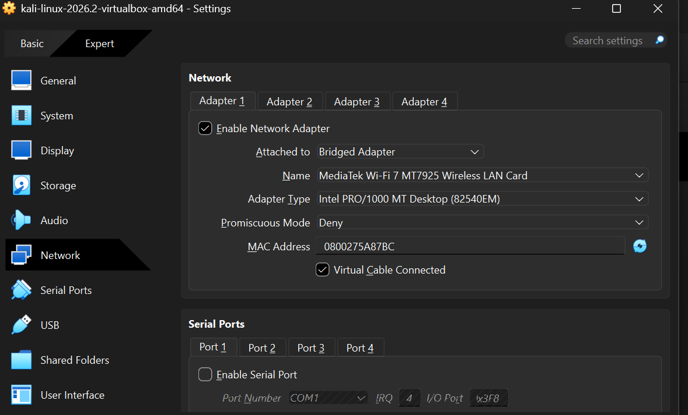
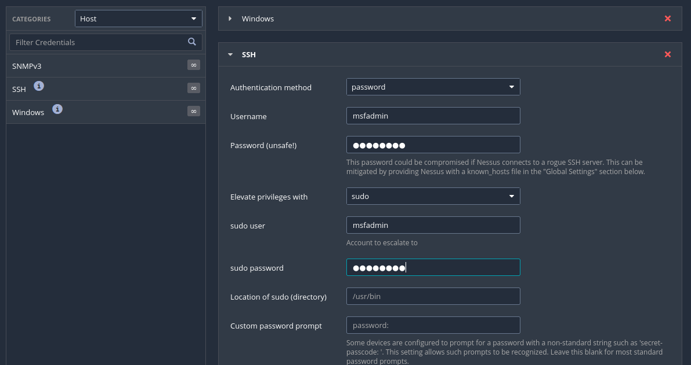
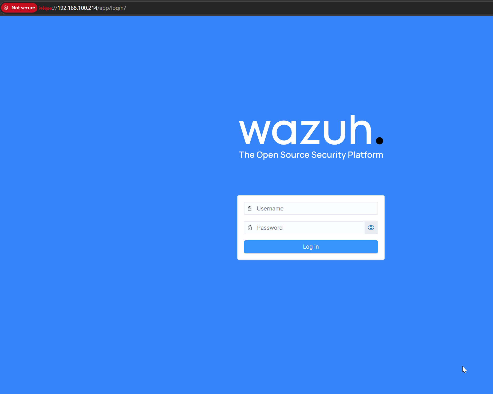

# Supplementary Evidence Gallery

Additional screenshots from `Cyber Home Lab Doc 1.docx` that support the implementation stages, troubleshooting, and configuration choices. For the main walkthrough, see [README](README.md).

> These images represent multiple configuration stages and exercises, not necessarily a single concurrent network.

## Host & virtualization

### Original image5.png — An alternative Kali adapter configuration using bridged networking during troubleshooting

*Source: embedded `word/media/image5.png` in `Cyber Home Lab Doc 1.docx`.*

## Connectivity testing

### Original image12.png — Windows host ping test showing unsuccessful replies while checking VM reachability

*Source: embedded `word/media/image12.png` in `Cyber Home Lab Doc 1.docx`.*

## Vagrant & Metasploitable 3

### Original image17.png — Vagrant installation wizard running on the Windows host

*Source: embedded `word/media/image17.png` in `Cyber Home Lab Doc 1.docx`.*

### Original image19.png — Vagrant configuration using the VirtualBox provider workflow

*Source: embedded `word/media/image19.png` in `Cyber Home Lab Doc 1.docx`.*

## Ubuntu Server

### Original image25.png — Ubuntu Server installation media used for the virtual server deployment

*Source: embedded `word/media/image25.png` in `Cyber Home Lab Doc 1.docx`.*

### Original image28.png — Ubuntu Server installer or terminal configuration stage

*Source: embedded `word/media/image28.png` in `Cyber Home Lab Doc 1.docx`.*

## Snort IDS

### Original image39.png — Snort-related command-line testing and log configuration

*Source: embedded `word/media/image39.png` in `Cyber Home Lab Doc 1.docx`.*

## pfSense firewall

### Original image51.png — VirtualBox network adapter settings for the pfSense exercise

*Source: embedded `word/media/image51.png` in `Cyber Home Lab Doc 1.docx`.*

## Windows Server & AD

### Original image83.png — Active Directory Users and Computers group management

*Source: embedded `word/media/image83.png` in `Cyber Home Lab Doc 1.docx`.*

## Nessus vulnerability scanning

### Original image90.png — Nessus setup/download interface used in the virtual assessment environment

*Source: embedded `word/media/image90.png` in `Cyber Home Lab Doc 1.docx`.*

### Original image107.png — Nessus credential configuration for an authenticated assessment

*Source: embedded `word/media/image107.png` in `Cyber Home Lab Doc 1.docx`.*

## Wazuh monitoring

### Original image114.png — Wazuh web interface sign-in screen

*Source: embedded `word/media/image114.png` in `Cyber Home Lab Doc 1.docx`.*

### Original image130.png — VirusTotal analysis of the harmless EICAR test sample used during monitoring validation

*Source: embedded `word/media/image130.png` in `Cyber Home Lab Doc 1.docx`.*

## Endpoint management

### Original image132.png — Action1 endpoint monitoring and patch management console

*Source: embedded `word/media/image132.png` in `Cyber Home Lab Doc 1.docx`.*
