# Supplementary Evidence Gallery

Additional screenshots that support the implementation stages, troubleshooting, and configuration choices. For the main walkthrough, see [README](README.md).

> These images represent multiple configuration stages and exercises, not necessarily a single concurrent network.

## Host & virtualization

### An alternative Kali adapter configuration using bridged networking during troubleshooting

## Connectivity testing

### Windows host ping test showing unsuccessful replies while checking VM reachability

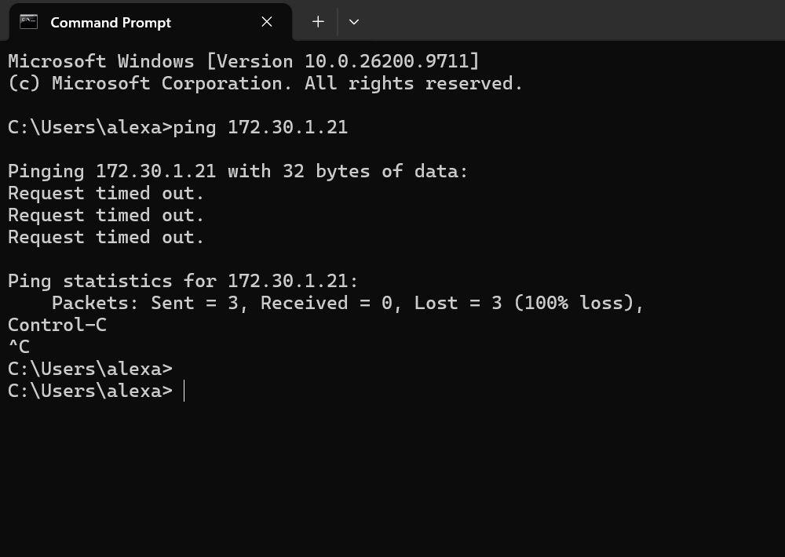

## Vagrant & Metasploitable 3

### Vagrant installation wizard running on the Windows host

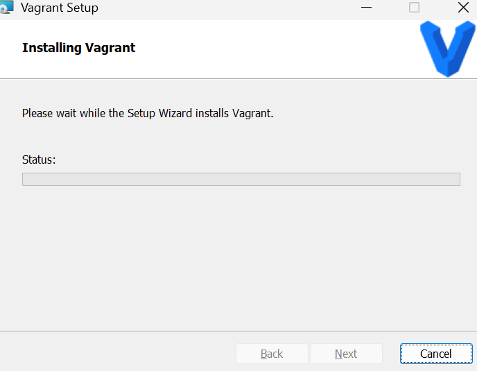

### Vagrant configuration using the VirtualBox provider workflow

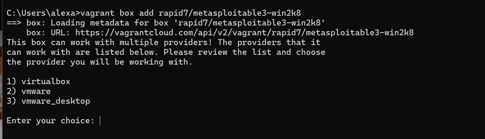

## Ubuntu Server

### Ubuntu Server installation media used for the virtual server deployment

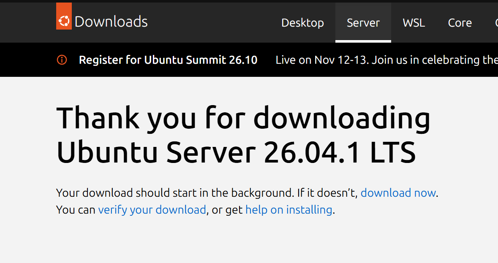

### Ubuntu Server installer or terminal configuration stage

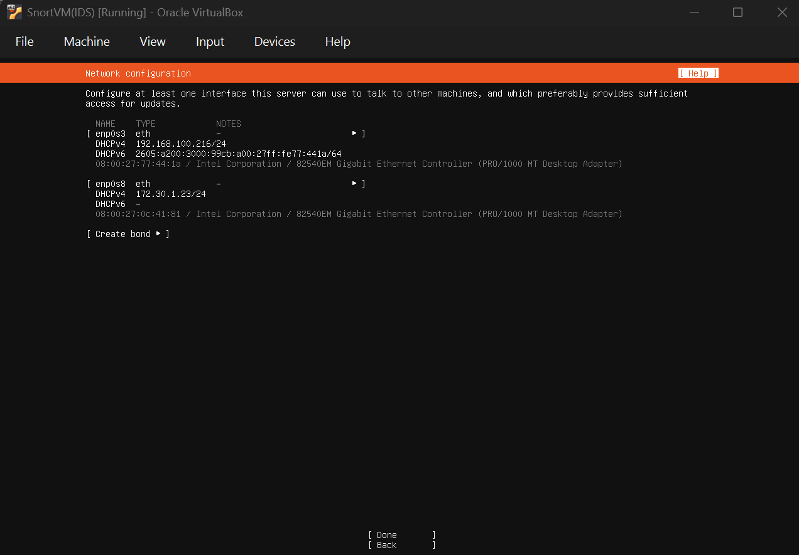

## Snort IDS

### Snort-related command-line testing and log configuration

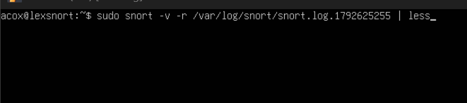

## pfSense firewall

### VirtualBox network adapter settings for the pfSense exercise

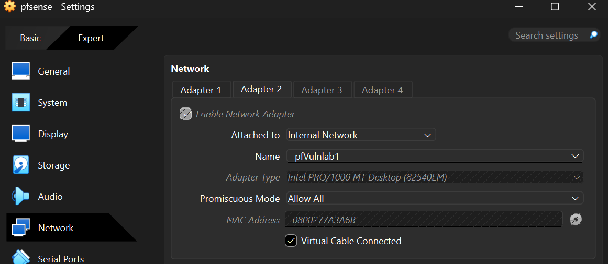

## Windows Server & AD

### Active Directory Users and Computers group management

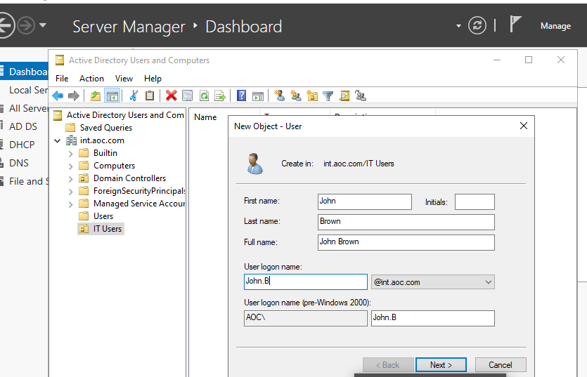

## Nessus vulnerability scanning

### Nessus setup/download interface used in the virtual assessment environment

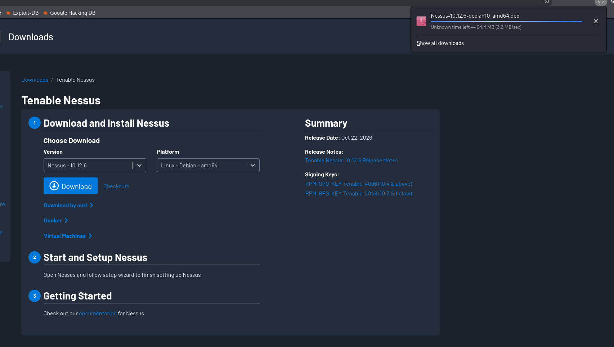

### Nessus credential configuration for an authenticated assessment

## Wazuh monitoring

### Original image114.png — Wazuh web interface sign-in screen

### VirusTotal analysis of the harmless EICAR test sample used during monitoring validation

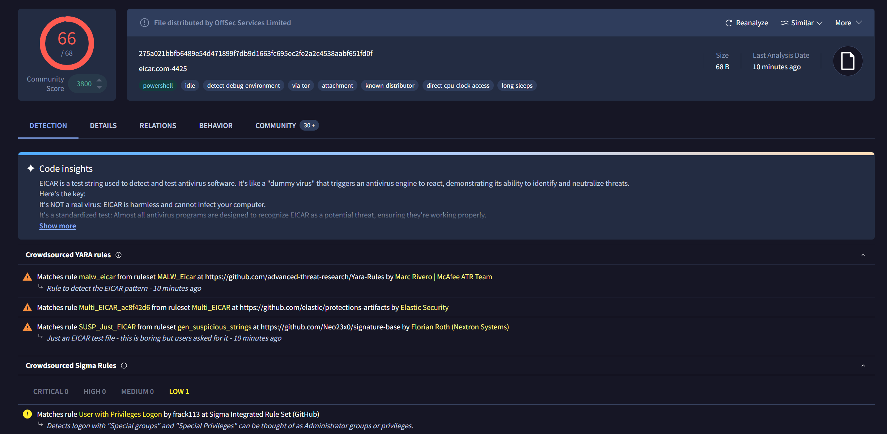

## Endpoint management

### Action1 endpoint monitoring and patch management console

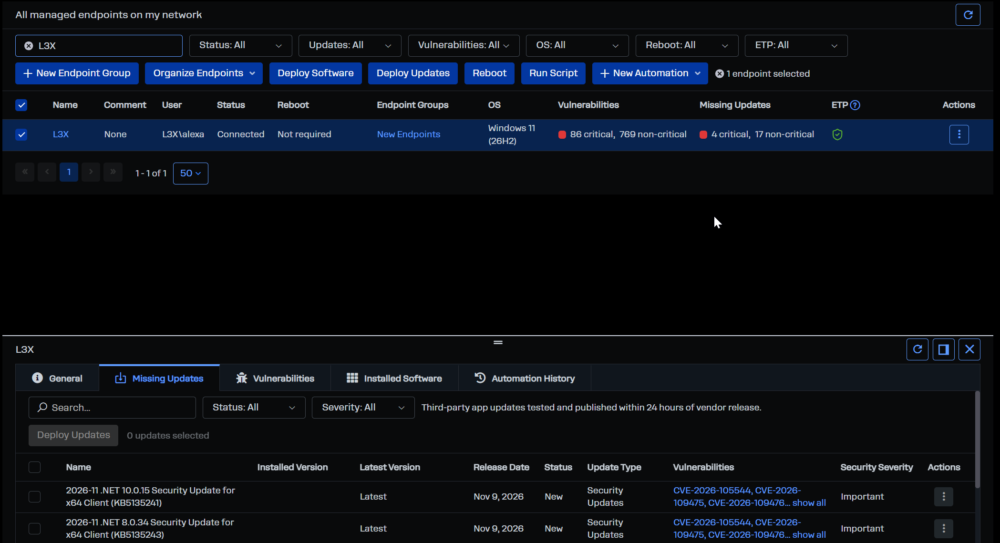

