# Cybersecurity Virtual Lab

**A multi-VM security lab built with VirtualBox and Vagrant: Kali Linux, deliberately vulnerable targets, and an Ubuntu Server, used for network testing and defensive practice.**

[](https://www.virtualbox.org/)
[](https://developer.hashicorp.com/vagrant)
[](https://www.kali.org/)
[](https://ubuntu.com/server)
[](https://nmap.org/)

> **Type:** Personal home lab (simulated, authorised environment) · **Author:** Alexander Cox

---

## Overview

This is the foundation of my security home lab. I built a set of virtual machines on a Windows host, configured isolated VirtualBox networks, and used Kali Linux to test connectivity and discover services on the lab targets. The same environment later hosted my firewall, IDS, SIEM, vulnerability-scanning and patch-management projects (linked [below](#where-the-lab-went-next)).

**What I practised**

- Creating and managing VMs, and choosing between **internal** and **bridged** VirtualBox networking
- Setting up a Kali Linux testing workstation
- Deploying **Metasploitable 2** and **Metasploitable 3** (provisioned with **Vagrant**) as practice targets
- Installing Ubuntu Server for later IDS work
- Verifying reachability with `ping` and mapping the network with **Nmap**

## Lab components

| VM / tool | Role in the lab |
|---|---|
| Windows host PC | Runs VirtualBox and Vagrant |
| Kali Linux | Testing workstation: ping, Nmap, network troubleshooting |
| Metasploitable 2 | Deliberately vulnerable Linux target |
| Metasploitable 3 | Vulnerable target provisioned with Vagrant |
| Ubuntu Server (`SnortVM`) | Linux server, later used for Snort IDS |

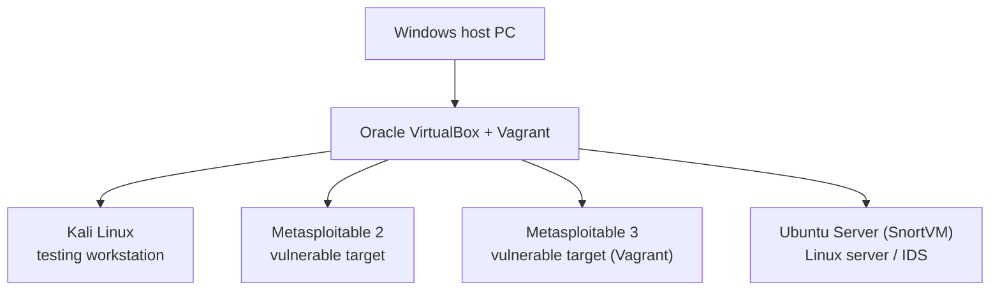

> The screenshots come from several lab sessions, so they show different adapter settings (for example `VulnLabs` and `Vulnlab1` internal networks, and a bridged test). The diagram shows what was built, not a single always-on network.

---

## Build walkthrough

### 1. Prepare the host and VirtualBox networking

I checked the Windows host, opened VirtualBox, and attached Kali to an **internal network** (`VulnLabs`) so the lab stays isolated from my home network.

<table>
<tr>
<td width="50%">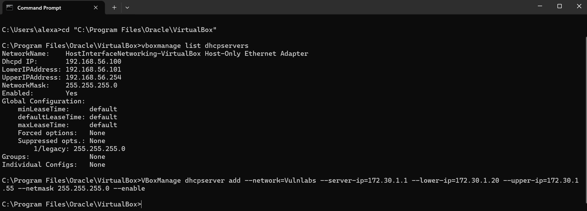<br><sub>Host-side networking checks</sub></td>
<td width="50%">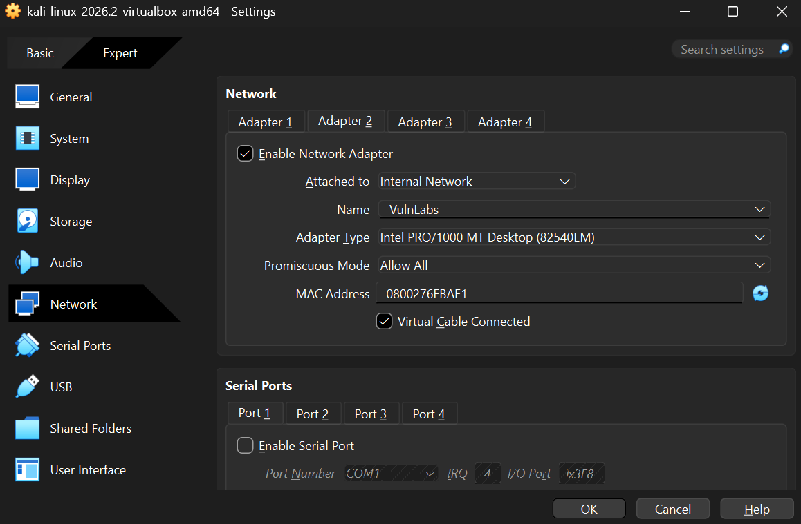<br><sub>Kali adapter on the <code>VulnLabs</code> internal network</sub></td>
</tr>
</table>

### 2. Set up Kali Linux

Kali is the main workstation for scanning and diagnostics. I confirmed its interface and addressing before testing any targets.

<table>
<tr>
<td width="50%">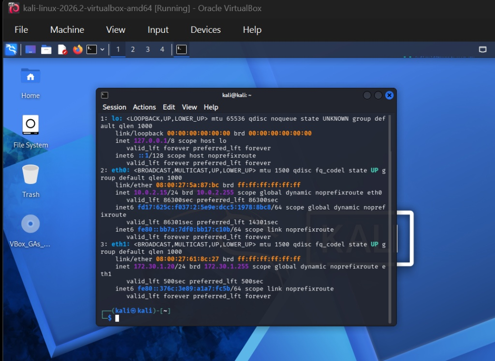<br><sub>Kali VM running</sub></td>
<td width="50%">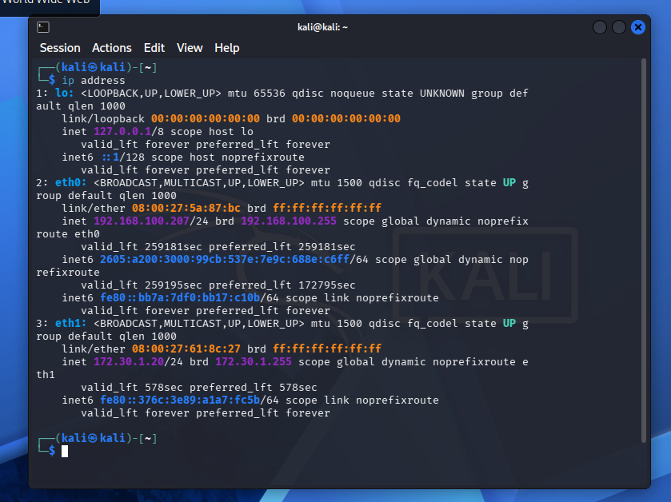<br><sub>Interface configuration</sub></td>
</tr>
</table>

### 3. Deploy Metasploitable 2

Metasploitable 2 sits on its own internal network (`Vulnlab1`) and is only used inside the lab.

<table>
<tr>
<td width="50%">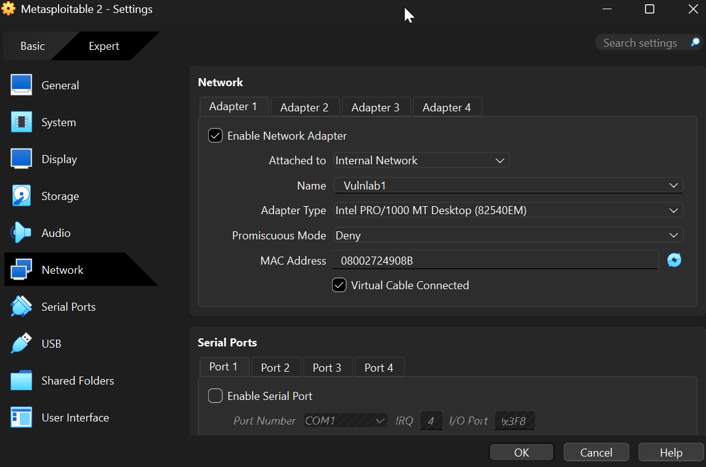<br><sub>Adapter on <code>Vulnlab1</code></sub></td>
<td width="50%">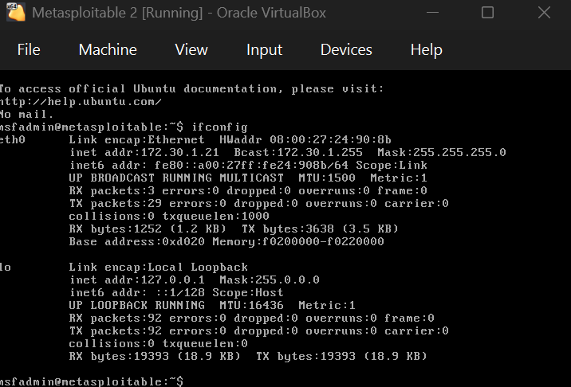<br><sub>Console with interface details</sub></td>
</tr>
</table>

### 4. Verify connectivity and discover hosts

From Kali I pinged lab hosts, then ran an Nmap ping sweep and a service scan.

```bash
ping 172.30.1.21
nmap -sn 172.30.1.1/24     # host discovery
```

<table>
<tr>
<td width="50%">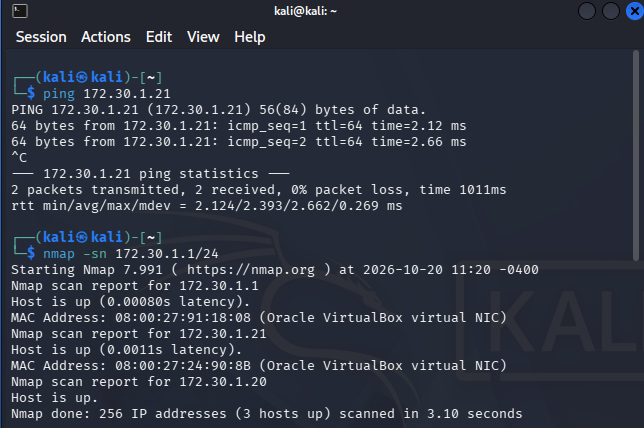<br><sub>Ping and Nmap host discovery</sub></td>
<td width="50%">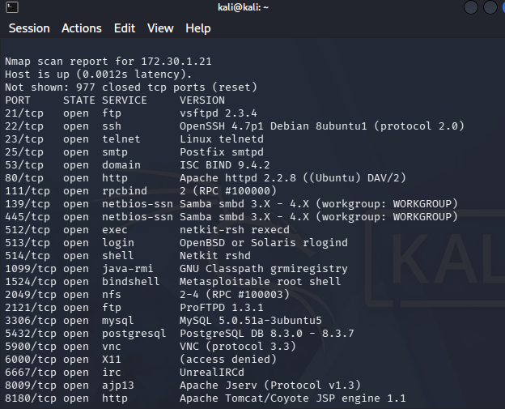<br><sub>Open ports and services on a lab host</sub></td>
</tr>
</table>

**Result:** Nmap reported **three hosts up** on `172.30.1.0/24`, and a service scan listed the ports and services exposed by a lab host.

### 5. Provision Metasploitable 3 with Vagrant

I installed Vagrant on the Windows host and used the VirtualBox provider to build and start Metasploitable 3 from the command line, instead of installing it by hand.

<table>
<tr>
<td width="50%">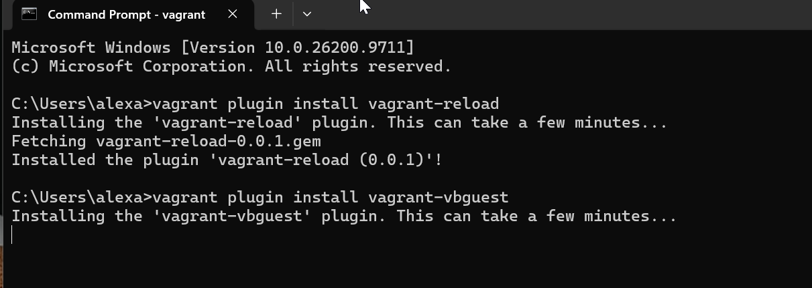<br><sub>Vagrant plugin setup</sub></td>
<td width="50%">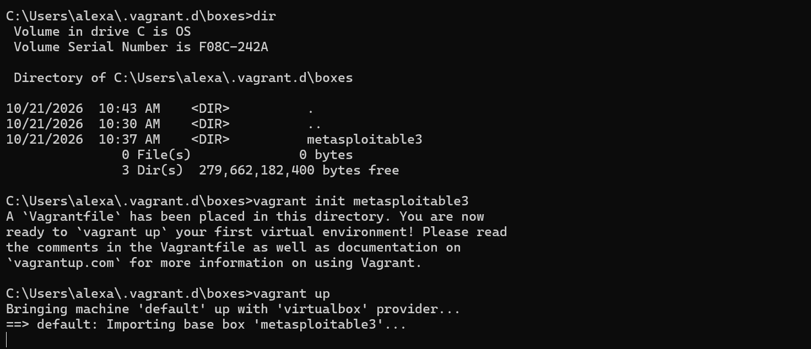<br><sub>Vagrant provisioning output</sub></td>
</tr>
<tr>
<td width="50%">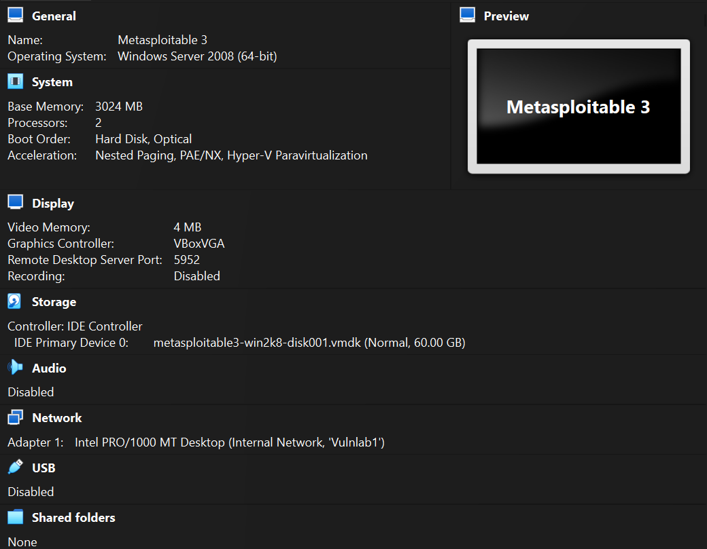<br><sub>VM registered in VirtualBox</sub></td>
<td width="50%">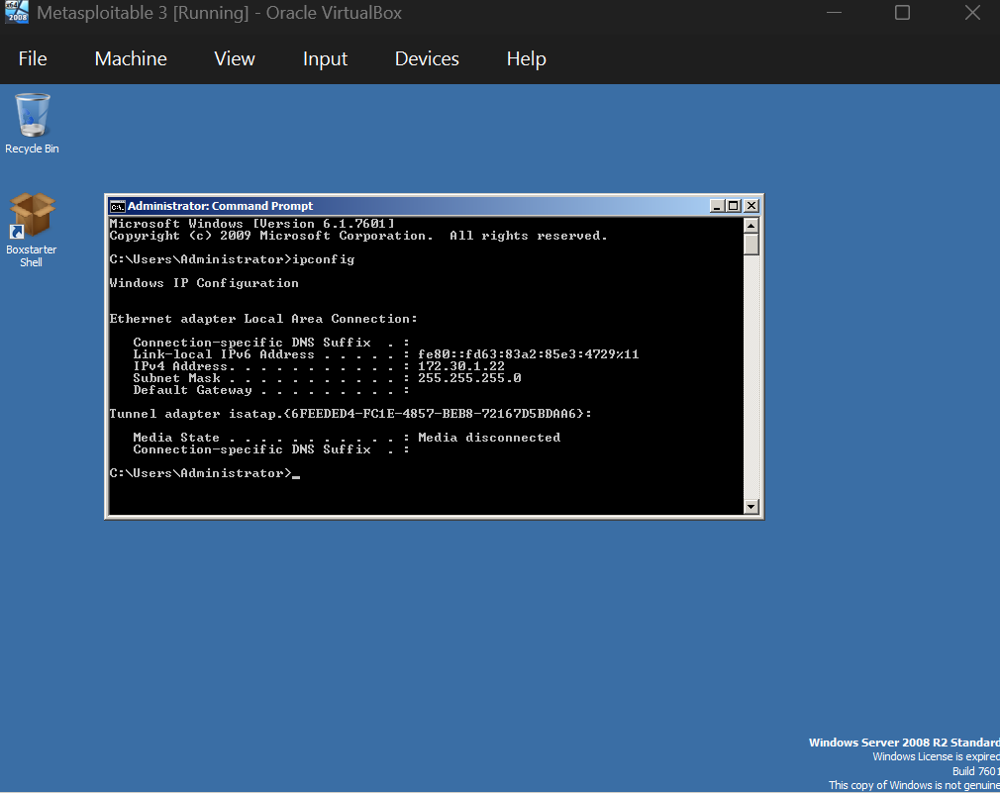<br><sub>Running Metasploitable 3 console</sub></td>
</tr>
</table>

### 6. Install Ubuntu Server (`SnortVM`)

I installed Ubuntu Server (24.04 LTS shown in the final console) as a VM named `SnortVM (IDS)`, then confirmed from Kali that it replied to ping at `172.30.1.26`.

<table>
<tr>
<td width="33%">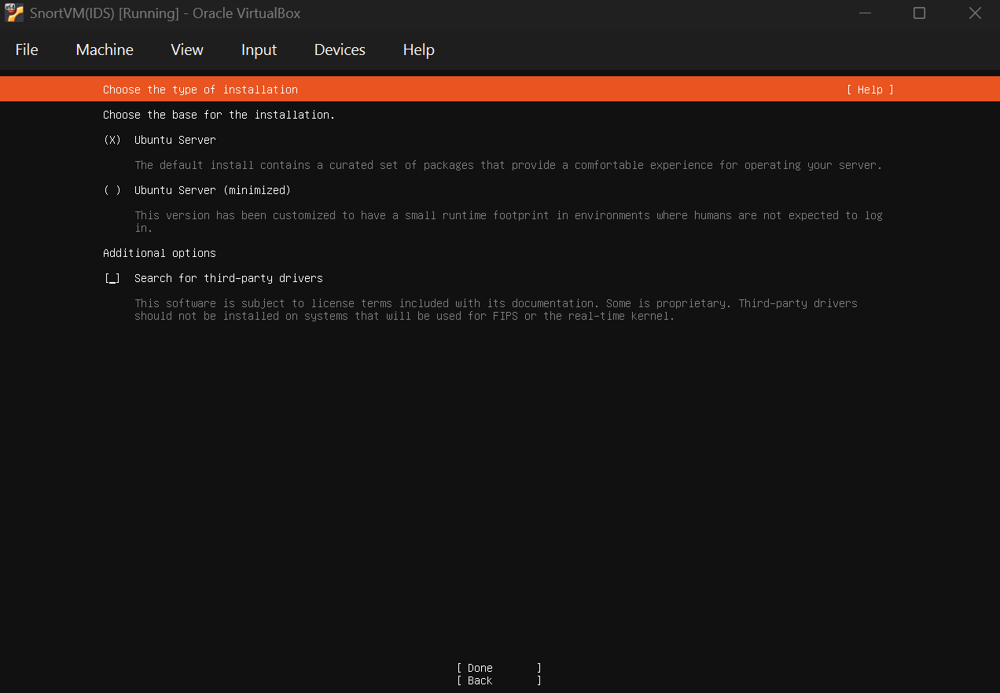<br><sub>Installer</sub></td>
<td width="33%">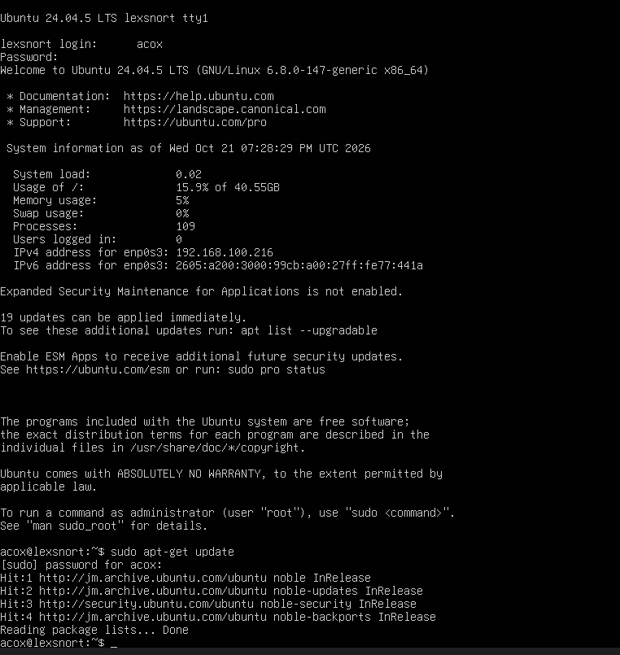<br><sub>Console after setup</sub></td>
<td width="33%">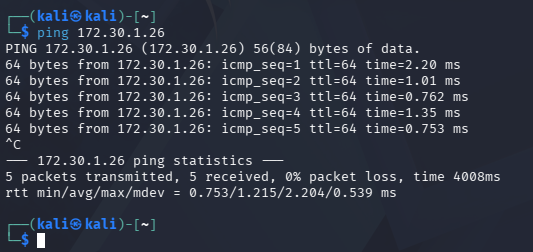<br><sub>Ping replies from Kali</sub></td>
</tr>
</table>

---

## Key results

| What I did | Evidence |
|---|---|
| Built a Kali + vulnerable-target lab in VirtualBox | Steps 1–3 |
| Used internal networks to keep the lab isolated | `VulnLabs` and `Vulnlab1` adapters |
| Found live hosts with Nmap | Three hosts up on `172.30.1.0/24` |
| Confirmed reachability between VMs | Ping replies from `172.30.1.21` and `172.30.1.26` |
| Provisioned a target with Vagrant | Metasploitable 3 built from the command line |
| Prepared a server for IDS work | Ubuntu Server `SnortVM` |

## Lessons learned

- **Network mode decides what can talk to what.** Internal, bridged and host-only adapters change both reachability and isolation, so I tested connectivity before every later exercise.
- **Failed tests are useful evidence.** My ping and bridged-adapter troubleshooting screenshots are in the [Evidence Gallery](EVIDENCE-GALLERY.md).
- **Automate provisioning.** Vagrant made the Metasploitable 3 build repeatable.
- **Keep vulnerable VMs isolated.** They should never be exposed to a home or production network.

## Where the lab went next

This environment is the base for my other projects. Each has its own repository with a full write-up:

- Snort Intrusion Detection
- pfSense Firewall Lab
- Windows Server and Active Directory
- Nessus Vulnerability Assessment
- Wazuh Security Monitoring
- Endpoint Patch Management (Action1)

See all of them on my [GitHub profile](https://github.com/KerberosAC).

## Scope and safety

This is a personal, simulated lab. The Metasploitable VMs are intentionally insecure and were used only on isolated virtual networks. Screenshots come from different sessions, so IP addresses and adapter names are historical lab data rather than one fixed topology. The repository contains no credentials, exploit payloads or production data.

**Author:** [Alexander Cox](https://www.linkedin.com/in/alexandercox25/) · [GitHub](https://github.com/KerberosAC)
