# Cybersecurity Virtual Lab | Multi-VM Infrastructure & Security Testing

[](https://www.virtualbox.org/)
[](https://developer.hashicorp.com/vagrant)
[](https://www.kali.org/)
[](https://ubuntu.com/server)
[](https://wazuh.com/)
[](https://www.pfsense.org/)


**Project type:** Personal cybersecurity Home Lab Summary  

## Overview

I designed and developed a multi-VM cybersecurity learning environment using **Oracle VirtualBox** and **Vagrant** on a Windows host. The lab allowed me to configure Linux systems and deliberately vulnerable practice targets, experiment with isolated network modes, validate connectivity, and build on the infrastructure with firewall, intrusion detection, directory services, vulnerability assessment, endpoint monitoring, and patch-management exercises.

The source document captures **multiple lab exercises and configuration stages**, not one single snapshot of a continuously running enterprise network. The README therefore distinguishes the *core lab build* from later security services, and does not assume every machine was simultaneously online or connected to the same subnet.

## Objectives

- Create and manage multiple VMs for controlled cybersecurity practice.
- Configure virtual adapters and explore **internal**, **bridged**, and other virtual networking options.
- Prepare a Kali Linux workstation and vulnerable Metasploitable targets.
- Use Vagrant with the VirtualBox provider to provision Metasploitable 3.
- Install and configure an Ubuntu Server environment.
- Validate network reachability with ICMP and discover hosts or services with Nmap.
- Extend the lab into defensive experiments using Snort, pfSense, Windows Server/Active Directory, Nessus, Wazuh, and Action1.
- Preserve configuration and results as repeatable evidence for a cybersecurity portfolio.

## Lab layout (plain text) — network connections and IP addresses

The topology below uses **addresses shown in the original Cyber Home Lab document**, including VM console output, VirtualBox configuration screenshots, the pfSense console, and Wazuh endpoint inventory. It groups systems by documented lab **exercise** rather than claiming all interfaces were connected simultaneously.

**Key:** `----ICMP ping---->` means communication was actually demonstrated; other branches indicate a documented VM, interface or shared IP range, **not** proven connectivity or routing.

```text
WINDOWS HOST PC  [Oracle VirtualBox / Vagrant]
|
+-- A. TARGET & RECONNAISSANCE LAB -- 172.30.1.0/24
|   |
|   +-- VirtualBox DHCP setup for "VulnLabs"
|   |     Server IP: 172.30.1.1
|   |     Pool:      172.30.1.20 - 172.30.1.55
|   |
|   +-- Kali Linux (testing VM)
|   |     eth1: 172.30.1.20/24
|   |     eth0: 192.168.100.207/24 (additional LAN adapter)
|   |
|   +-- Metasploitable 2 (vulnerable Linux VM)
|   |     eth0: 172.30.1.21/24
|   |     VM adapter screenshot: internal network "Vulnlab1"
|   |
|   +-- Metasploitable 3 (vulnerable Windows VM)
|   |     IPv4: 172.30.1.22/24
|   |     VM adapter screenshot: internal network "Vulnlab1"
|   |     Provisioned with Vagrant + VirtualBox
|   |
|   +-- Other observations (VM identity not established):
|   |     172.30.1.18  -- seen as active in an Nmap discovery scan
|   |     172.30.1.26  -- responded to Kali ping in a later test
|   |
|   `-- VERIFIED COMMUNICATION:
|         Kali 172.30.1.20 ----ICMP ping----> 172.30.1.21
|         Kali scanned 172.30.1.0/24 (three hosts observed in one scan)
|
+-- B. pfSense FIREWALL EXERCISE -- 172.30.2.0/24
|   |
|   +-- pfSense VM
|   |     WAN em0: 192.168.100.245/24 (DHCP)
|   |     LAN em1: 172.30.2.1/24
|   |     Internal adapter name shown: "pfVulnlab1"
|   |
|   `-- Kali Linux (later Wazuh network inventory)
|         eth1: 172.30.2.100/24
|         Same subnet as pfSense LAN; direct traffic path not proven
|
+-- C. OBSERVED EXTERNAL / BRIDGED-SIDE LAN -- 192.168.100.0/24
|   |
|   +-- Windows11HostPC (Wazuh inventory): Wi-Fi 192.168.100.70
|   +-- Kali Linux:                     eth0  192.168.100.207
|   +-- Ubuntu Server / SnortVM:        enp0s3 192.168.100.216
|   +-- Wazuh manager (Ubuntu):         enp0s3 192.168.100.214
|   +-- pfSense WAN:                    em0   192.168.100.245
|   `-- Additional monitored laptop:          192.168.100.215
|       (These addresses share a CIDR; their direct paths were not mapped.)
|
+-- D. SEPARATE VIRTUALBOX HOST-ONLY DHCP CONFIGURATION
|   `-- 192.168.56.100 = DHCP server
|       Lease pool: 192.168.56.101 - 192.168.56.254 /24
|       (No specific VM-to-this-network attachment was verified.)
|
`-- E. OTHER DOCUMENTED SYSTEMS / MANAGEMENT TOOLS
    +-- Windows Server 2022 / DC01: Active Directory + DNS
    |     IP address: not shown in the evidence
    +-- Snort IDS: tested in its Ubuntu/pfSense lab contexts
    +-- Nessus: vulnerability-assessment application
    `-- Action1: endpoint management application
          (Nessus and Action1 are tools, not necessarily separate VMs.)
```

**Important network-name discrepancy:** The screenshots show Kali configured on VirtualBox's internal network `VulnLabs`, while Metasploitable 2 and 3 are shown using `Vulnlab1`. These are *different VirtualBox network names*, even though the machines' console screenshots use the `172.30.1.0/24` address range. The successful Kali-to-Metasploitable 2 ping confirms reachability **at the time of that test**; it does not establish that the adapter-setting screenshots represent one unchanged configuration.

**Separate lab stages:** The `172.30.2.100` Kali address comes from a **later Wazuh endpoint inventory** and is not the same snapshot as Kali's earlier `172.30.1.20` address. The pfSense LAN IP is documented as `172.30.2.1`, but no direct Kali-to-pfSense ping or routing trace was provided. Similarly, the `192.168.100.x` addresses document interfaces on the same address range, not a complete switching or routing map.

### Network address evidence

| Device or service | Address / range | Evidence from the lab |
|---|---|---|
| VirtualBox `VulnLabs` DHCP server | `172.30.1.1`, pool `172.30.1.20–55` | [Windows host VBoxManage screenshot](screenshots/01-windows-host-network-discovery.png) |
| VirtualBox host-only DHCP service | `192.168.56.100`, pool `192.168.56.101–254` | [Windows host VBoxManage screenshot](screenshots/01-windows-host-network-discovery.png) |
| Kali Linux | `172.30.1.20` (`eth1`); `192.168.100.207` (`eth0`) | [Kali interface screenshot](screenshots/05-kali-network-interface-configuration.png) |
| Metasploitable 2 | `172.30.1.21` | [Linux console](screenshots/07-metasploitable2-network-console.png) |
| Metasploitable 3 | `172.30.1.22` | [Windows console](screenshots/16-metasploitable3-console.png) |
| Ubuntu Server / SnortVM | `192.168.100.216` | [Ubuntu terminal](screenshots/20-ubuntu-server-post-install-console.png) |
| pfSense | WAN `192.168.100.245`; LAN `172.30.2.1` | [pfSense console](screenshots/26-pfsense-vm-console.png) |
| Wazuh manager | `192.168.100.214` | [Wazuh Ubuntu IP output](screenshots/50-wazuh-server-ip-address.png) |
| Kali Linux (later inventory) | `172.30.2.100` (`eth1`) | [Wazuh endpoint network inventory](screenshots/51-wazuh-endpoint-network-addresses.png) |
| `Windows11HostPC` (inventory) | `192.168.100.70` (Wi-Fi) | [Wazuh endpoint network inventory](screenshots/51-wazuh-endpoint-network-addresses.png) |
| Additional Wazuh-monitored laptop | `192.168.100.215` | [Wazuh endpoint network inventory](screenshots/51-wazuh-endpoint-network-addresses.png) |
| Windows Server 2022 / DC01 | **Not shown** (DHCP indicated) | [Windows Server Manager](screenshots/32-windows-server-manager.png) |

**Interpretation:** CIDR membership alone does **not** confirm VirtualBox internal-network membership, reachability or firewall forwarding. IPs and adapter modes were captured at different points in the lab; do not treat the drawing as a production-grade verified routing diagram.

### Extended virtual lab inventory

The original document also shows additional machines and platforms deployed or accessed during later exercises:

| Component | Purpose | Source evidence |
|---|---|---|
| Windows PC | Host for VirtualBox and Vagrant workflows | Host command prompt and VirtualBox settings |
| Kali Linux VM | Security testing, scanning, network troubleshooting | Kali terminal, network adapter, ping and Nmap results |
| Metasploitable 2 VM | Intentionally vulnerable Linux target | Internal-network settings and running console |
| Metasploitable 3 VM | Deliberately vulnerable target prepared through Vagrant | Vagrant logs, VirtualBox VM, console |
| Ubuntu Server VM | General-purpose Linux server environment | Installation and console screenshots |
| Snort VM / IDS work | Intrusion detection experiments | Snort installation and monitoring evidence |
| pfSense VM | Firewall and network security policy experimentation | pfSense console, GUI and LAN rules |
| Windows Server / Active Directory | Directory service and DNS administration | Server Manager and AD/DNS consoles |
| Nessus | Vulnerability assessment | Scan templates, result dashboards and credential settings |
| Wazuh server and endpoints | Centralized endpoint monitoring | Wazuh dashboard, inventory and vulnerability findings |
| Action1 | Endpoint inventory and patch management | Action1 device and management views |

**Topology caveat:** These are documented lab components across multiple exercises. VirtualBox networking screenshots explicitly show more than one configuration; the document does **not** establish one final interconnection or IP address for every system. Do not interpret the text-layout branches as verified network connections or packet paths.

### Network configuration and addressing evidence

- One Kali VirtualBox screenshot shows **Internal Network: `VulnLabs`**.
- Another Kali adapter screenshot shows a **Bridged Adapter** configuration; the lab explored more than one mode.
- A Metasploitable 2 screenshot shows **Internal Network: `Vulnlab1`**.
- A Kali test shows ping replies from **`172.30.1.21`**, followed by an Nmap discovery pass over **`172.30.1.0/24`** reporting **three active hosts**.
- Another connectivity test shows successful replies from **`172.30.1.26`**.
- These observations document connectivity at particular test stages; they are **not** proof of an unchanged final network topology.

## Tools and technologies

| Area | Tools |
|---|---|
| Virtualization & provisioning | Oracle VirtualBox, HashiCorp Vagrant |
| Operating systems | Windows host, Kali Linux, Ubuntu Server, Metasploitable 2 / 3, Windows Server |
| Networking & discovery | VirtualBox virtual adapters, `ping`, Nmap, Linux terminal utilities |
| Network security | pfSense, Snort |
| Identity & infrastructure | Windows Server, Active Directory, DNS |
| Vulnerability assessment | Nessus |
| Security monitoring | Wazuh, VirusTotal/EICAR test artifacts |
| Endpoint management | Action1 |

---

## Implementation & command walkthrough

The sections below explain the **commands visible in the original screenshots**, their parameters, what was observed, and why each activity mattered. Commands from screenshots are labeled **Documented command**. Additional commands are labeled **Optional follow-up**; they are useful for recreating or validating a lab, but I am **not claiming they were executed in the source document**.

The work was performed in a **controlled personal lab**. Target addresses refer to private virtual networks captured at different dates and setup stages. In particular, the VirtualBox network labels `VulnLabs` and `Vulnlab1` are not identical, so the README does not assert that every screenshot represents a single final configuration.

### 1. Set up VirtualBox networking and DHCP

**Goal:** Build a way for lab VMs to obtain addresses and communicate without relying on their default guest configurations.

I used the **Windows host Command Prompt** to inspect VirtualBox DHCP settings and prepare a DHCP scope for the lab network. The host also showed a separate host-only DHCP range, `192.168.56.101–192.168.56.254`.

**Documented commands (Windows Command Prompt):**

```bat
cd "C:\Program Files\Oracle\VirtualBox"
VBoxManage list dhcpservers
VBoxManage dhcpserver add --network=VulnLabs --server-ip=172.30.1.1 --lower-ip=172.30.1.20 --upper-ip=172.30.1.55 --netmask 255.255.255.0 --enable
```

| Element | What it does |
|---|---|
| `cd "C:\Program Files\Oracle\VirtualBox"` | Changes to the directory containing the VirtualBox command-line utility; quotes protect spaces in the Windows path. |
| `VBoxManage` | Oracle VirtualBox's command-line administration tool. |
| `list dhcpservers` | Displays configured VirtualBox DHCP services and their lease pools. |
| `dhcpserver add` | Defines a new DHCP configuration for a VirtualBox-managed network. |
| `--network=VulnLabs` | Associates the DHCP configuration with the named VirtualBox network. |
| `--server-ip=172.30.1.1` | Sets the DHCP server's configured address. |
| `--lower-ip` / `--upper-ip` | Set the allocation range, here `172.30.1.20` through `172.30.1.55`. |
| `--netmask 255.255.255.0` | Uses a `/24` subnet mask. |
| `--enable` | Enables this DHCP configuration. |

**What the screenshot demonstrates:** The host's DHCP listing showed an existing host-only DHCP server, and the subsequent command prepared a separate `172.30.1.0/24` scope. The terminal returning to the prompt is evidence of the command being submitted without visible error, but it is **not a saved DHCP lease report**.

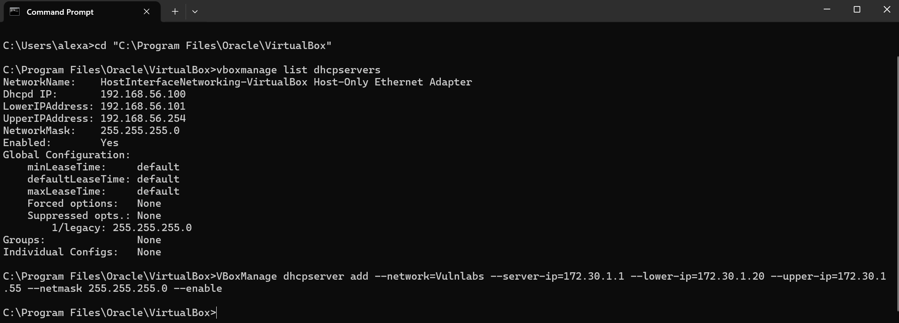

*Figure 1 — Windows host: listing DHCP services and defining the `VulnLabs` lease range.*

Next, in VirtualBox I edited VM **Settings → Network**. The screenshots show Kali attached to an *Internal Network* named `VulnLabs`, and also show a **Bridged Adapter** configuration during a separate stage.

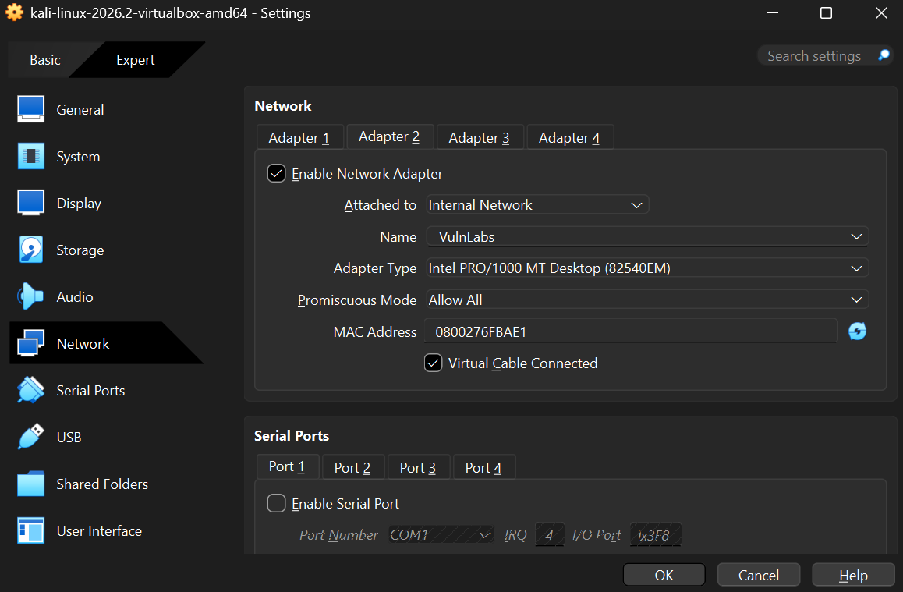

*Figure 2 — Kali adapter configured to use the named internal VirtualBox network.*

**Why adapter mode matters:** An *Internal Network* only connects virtual machines using the same named VirtualBox internal network. A *Bridged Adapter* places a guest's interface onto an external/LAN-side segment. Host-only networking is a different configuration that enables host/guest communications; the screenshots do not prove it was the final mode for every machine.

### 2. Start Kali Linux and inspect assigned interfaces

**Goal:** Determine which network interface Kali uses to reach the practice targets and which interface belongs to the broader LAN.

**Documented command:**

```bash
ip address
```

`ip` is the Linux networking utility and `address` prints addresses associated with each interface. The screenshot displays loopback (`lo`), `eth0`, and `eth1`, together with interface status, prefix length, and broadcast addresses.

| Interface | Address observed | Role in this snapshot |
|---|---|---|
| `lo` | `127.0.0.1/8` | Local loopback; not a VM-to-VM route. |
| `eth0` | `192.168.100.207/24` | Broader LAN-side interface in this configuration. |
| `eth1` | `172.30.1.20/24` | Internal vulnerable-target lab interface. |

The output showed `state UP` for both Ethernet interfaces, confirming that Linux recognized active interfaces. An interface being **UP** does not, by itself, prove that it can reach a particular destination.

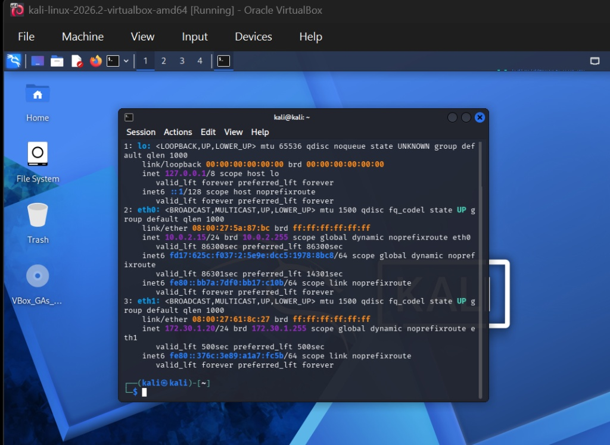

*Figure 3 — Kali desktop and terminal running inside VirtualBox.*

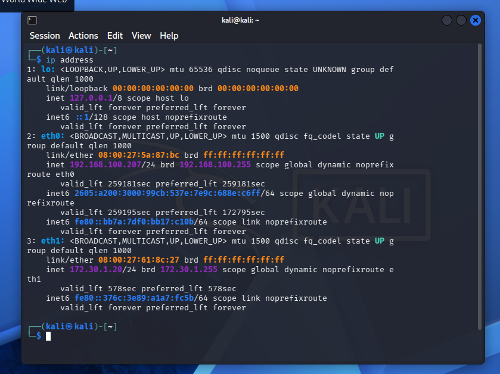

*Figure 4 — `ip address` shows Kali's dual-interface arrangement.*

**Optional follow-up (not documented as executed in this screenshot):**

```bash
ip route
```

This would display the selected routes and default gateway, which are needed before claiming how packets travel between the LAN, internal networks, and pfSense.

### 3. Prepare Metasploitable 2 and verify its address

**Goal:** Make an intentionally vulnerable VM available as a target for network discovery and service enumeration.

The screenshots document a Metasploitable 2 VirtualBox adapter named `Vulnlab1` and a running VM console. The network name differs from the Kali `VulnLabs` settings screenshot; both are retained as configuration evidence from different stages rather than silently changed to match.

**Documented command on Metasploitable 2:**

```bash
ifconfig
```

`ifconfig` shows legacy Linux interface information, including IP address, subnet mask, MAC address, and traffic counters. It identified Metasploitable 2 as **`172.30.1.21/24`** in the observed stage.


*Figure 5 — Metasploitable 2 attached to `Vulnlab1` in a VirtualBox settings screenshot.*

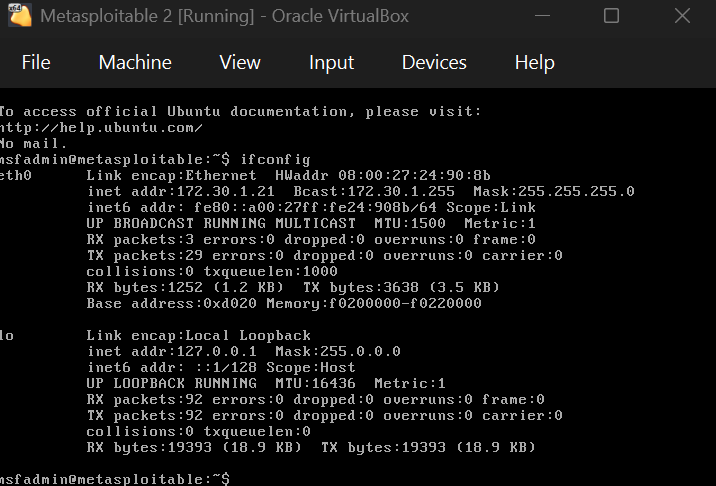

*Figure 6 — Metasploitable 2 console network output used to identify the target's address.*

**Why this matters:** Knowing the IP before scanning prevents accidentally targeting an unrelated machine. Intentionally vulnerable VMs should remain isolated from production or untrusted networks.

### 4. Test reachability and discover active lab hosts

**Goal:** Verify that Kali could reach Metasploitable 2 and discover other active hosts on the target subnet.

**Documented commands from Kali:**

```bash
ping 172.30.1.21
nmap -sn 172.30.1.1/24
```

| Command element | Meaning |
|---|---|
| `ping` | Sends ICMP Echo Requests and reports replies, latency, and packet loss. |
| `172.30.1.21` | The Metasploitable 2 test destination in this snapshot. |
| `nmap` | Network reconnaissance tool used to enumerate live systems and services. |
| `-sn` | Host discovery only; disables the ordinary port scan. |
| `172.30.1.1/24` | A CIDR-specified target network covering the `172.30.1.0/24` address block. |

**Observed results:** Kali received **2 of 2 ping replies with 0% packet loss** from `172.30.1.21`. The Nmap discovery output identified **three active hosts** (`172.30.1.18`, `.21`, and `.20`) in the tested `/24` range. An earlier Windows host ping attempt had failed, illustrating that reachability changed with interface and network-mode setup.


*Figure 7 — Verified Kali-to-Metasploitable 2 communication and three-host Nmap discovery.*

### 5. Inventory vulnerable network services with Nmap

**Goal:** Move from “which hosts exist?” to “which services are reachable on the vulnerable target?”

The Nmap **result screenshot** for `172.30.1.21` includes open TCP ports and service/version information. The exact invocation for this separate result is not visible in the selected image, so I do **not** attribute a specific `-sV` command to the source. For context, the following is a **reproducible example**, not a separately verified executed command:

```bash
nmap -sV 172.30.1.21
```

- `-sV` requests service/version detection for ports discovered open.
- The target address is the documented deliberately vulnerable Metasploitable 2 VM.
- The returned inventory helps prioritize patching, access controls, or further **authorized** lab validation; it is not proof that every service was exploited.

**Examples visible in the actual results:**

| Port | Service | Identification shown |
|---|---|---|
| `21/tcp` | FTP | vsftpd 2.3.4 |
| `22/tcp` | SSH | OpenSSH 4.7p1 Debian |
| `23/tcp` | Telnet | Linux telnetd |
| `80/tcp` | HTTP | Apache httpd 2.2.8 |
| `139`, `445/tcp` | SMB | Samba 3.x–4.x family in scanner output |
| `3306/tcp` | MySQL | MySQL 5.0.51a |
| `8180/tcp` | HTTP | Apache Tomcat/Coyote JSP engine 1.1 |


*Figure 8 — Nmap service inventory for the intentionally vulnerable Linux guest.*

**Interpretation:** Exposed FTP, Telnet, SMB, database, and web services increase the visible attack surface. The scan identifies candidates for assessment; the screenshot alone does not establish that those services were attacked successfully in this project.

### 6. Install Vagrant and provision Metasploitable 3

**Goal:** Create a more repeatable virtual-machine deployment workflow instead of manually installing every practice target.

Vagrant works with a provider such as VirtualBox. Its *box* serves as a reusable VM template; a `Vagrantfile` defines how the VM should be started.

**Documented commands (Windows):**

```bat
vagrant plugin install vagrant-reload
vagrant plugin install vagrant-vbguest
vagrant box add rapid7/metasploitable3-win2k8
vagrant init metasploitable3
vagrant up
```

| Command | Why it was used |
|---|---|
| `vagrant plugin install vagrant-reload` | Installs a helper plugin that can manage reboots during provisioning. The screenshot confirms this plugin installed successfully. |
| `vagrant plugin install vagrant-vbguest` | Starts installing the plugin used for VirtualBox guest additions; completion is **not** shown in the screenshot. |
| `vagrant box add rapid7/metasploitable3-win2k8` | Retrieves/registers the named Rapid7 Metasploitable 3 Windows template from Vagrant Cloud; the screenshot shows the provider selection prompt. |
| `vagrant init metasploitable3` | Creates a `Vagrantfile` for the box label used in the working directory; the terminal confirms a file was created. |
| `vagrant up` | Starts the VM using the configured provider; the screenshot shows it importing the base box with `virtualbox`. |

**Important:** The box was added under its `rapid7/metasploitable3-win2k8` name, while `vagrant init` used `metasploitable3` in the captured working directory. These commands come from different screenshots/stages. Repeating them verbatim may require adapting the local box name and `Vagrantfile`; the screenshots do not provide the entire file contents.


*Figure 9 — Plugin installation; successful `vagrant-reload` result is visible.*


*Figure 10 — `vagrant init` creates a Vagrantfile and `vagrant up` begins importing a VirtualBox base box.*

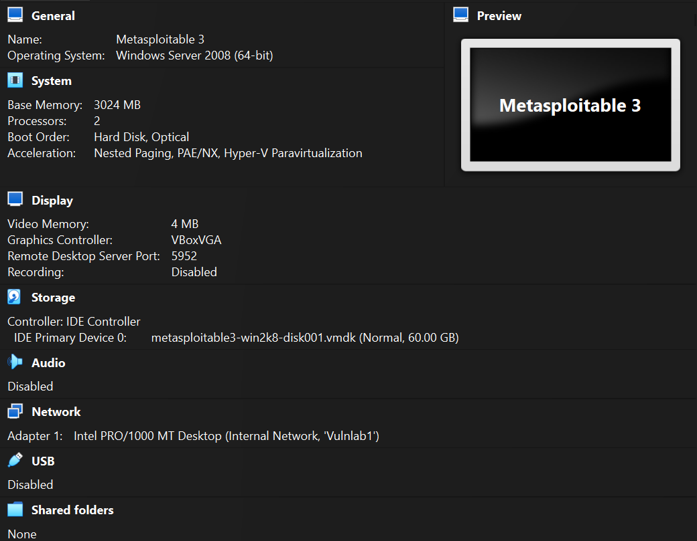

*Figure 11 — Metasploitable 3 VM listed in the hypervisor.*

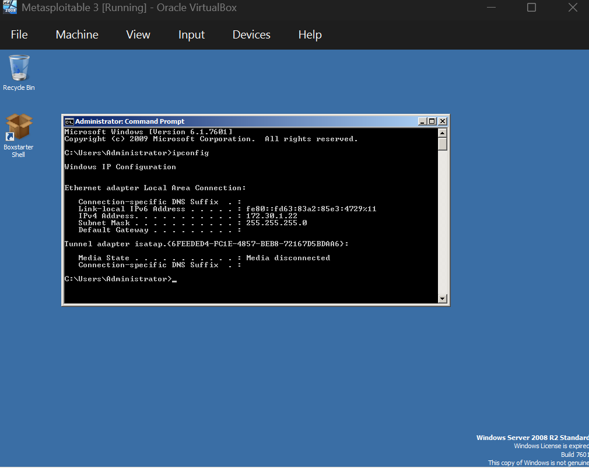

*Figure 12 — Running Metasploitable 3 console, with `172.30.1.22` documented for one configuration.*

**Observed result:** There is evidence of the box workflow and a booted Windows-based vulnerable target. Metasploitable 3 is distinct from Metasploitable 2; its screenshots and addresses are not interchangeable.

### 7. Create Ubuntu Server and verify later connectivity

**Goal:** Add a Linux server for administration and security services, including a Snort-focused VM.

The document contains an Ubuntu Server download page, installation screens in a VirtualBox VM named `SnortVM (IDS)`, and a terminal after installation. The download screenshot references Ubuntu 26.04.1, while a post-install screenshot identifies a different installed release. I have not standardized those details into a single version claim.

**Documented connectivity command (Kali):**

```bash
ping 172.30.1.26
```

`ping` verifies whether the destination responds to ICMP. In the screenshot, **5 packets were sent and 5 were received (0% loss)**. Later Snort alerts also reference traffic between `172.30.1.20` and `172.30.1.26`, supporting their role in one monitored test stage.

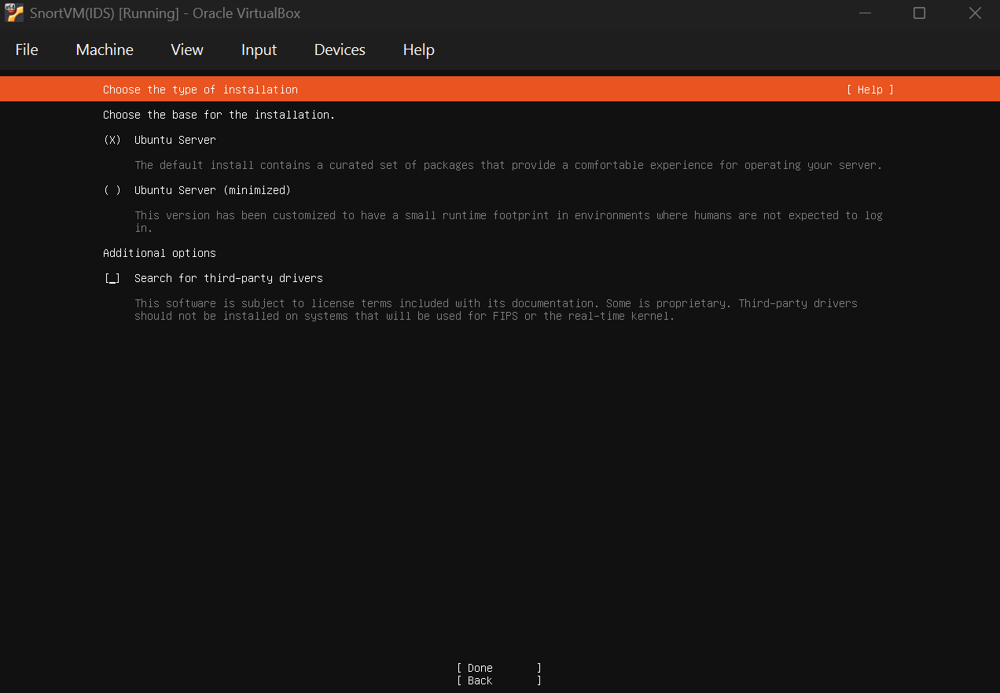

*Figure 13 — Ubuntu server installation in the `SnortVM (IDS)` virtual machine.*

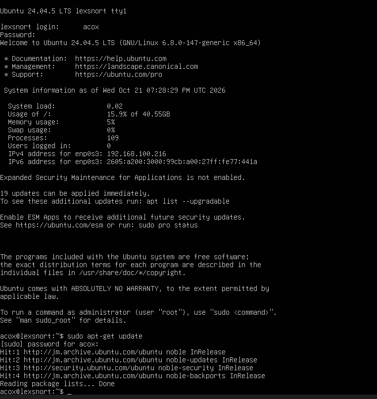

*Figure 14 — Login/terminal evidence following the Ubuntu setup.*

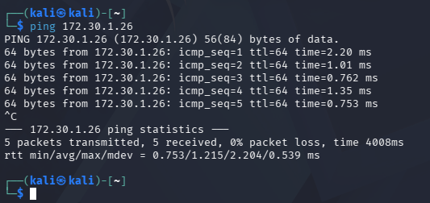

*Figure 15 — Successful ICMP communication to the observed lab endpoint.*

### 8. Configure Snort IDS, validate rules, and observe traffic

**Goal:** Use an intrusion detection system to inspect activity generated in the isolated network.

The screenshot shows **Snort 2.9.20**, its initialization, a successful configuration validation message, and a command line for testing the configuration.

**Documented configuration test command:**

```bash
sudo snort -T -i enp0s8 -c /etc/snort/snort.conf
```

| Option | Explanation |
|---|---|
| `sudo` | Runs with the privileges needed for network capture and Snort processing. |
| `snort` | Invokes the Snort IDS engine. |
| `-T` | Checks Snort configuration and rules instead of running ordinary live monitoring. |
| `-i enp0s8` | Selects the VM's capture interface. |
| `-c /etc/snort/snort.conf` | Loads the specified Snort configuration file. |

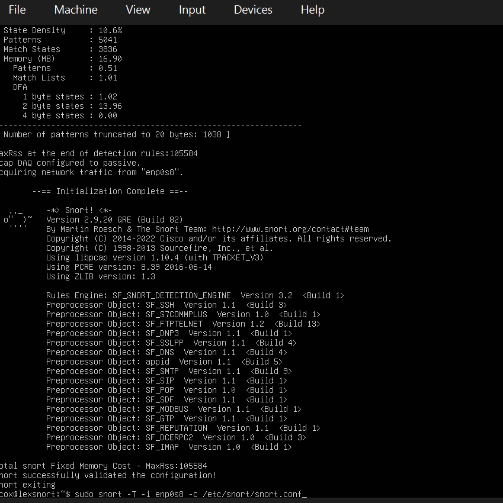

*Figure 16 — Snort configuration/initialization output and test command.*

The subsequent monitoring screenshot shows the following **documented live-monitoring command**:

```bash
sudo snort -q -l /var/log/snort -i enp0s8 -A console -c /etc/snort/snort.conf
```

- `-q` reduces startup information to make alerts easier to read.
- `-l /var/log/snort` sets the output log directory.
- `-i enp0s8` tells Snort which interface to inspect.
- `-A console` sends alerts to the terminal.
- `-c` loads the defined rules/configuration.

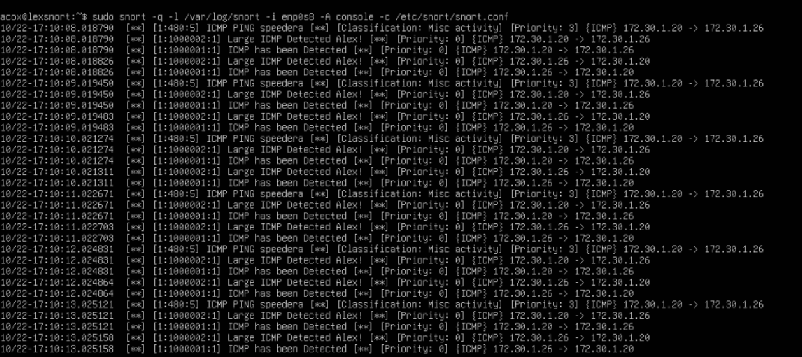

*Figure 17 — Console alerts such as `ICMP PING speedera`, `Large ICMP Detected`, and `ICMP has been Detected` for traffic between `172.30.1.20` and `172.30.1.26`.*

A supplemental screenshot shows this **documented command being prepared** to read a saved Snort log:

```bash
sudo snort -v -r /var/log/snort/snort.log.1792625255 | less
```

- `-v` requests verbose packet information.
- `-r` reads packets from the specified captured file instead of capturing live traffic.
- `| less` pages potentially long terminal output.
- This screenshot shows the command line, **not** the full resulting packet listing.

A separate Kali scan targeted the same observed lab endpoint:

```bash
nmap -sS 172.30.1.26
```

`-sS` requests a TCP SYN scan; it is not a substitute for an IDS alert. The result showed **`22/tcp open ssh`**, while 999 scanned ports were reported closed in that capture.

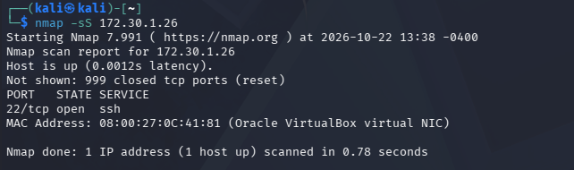

*Figure 18 — A controlled SYN scan of the lab endpoint (`172.30.1.26`).*

**Outcome:** Snort visibly generated **ICMP alerts** during lab testing, and Kali separately confirmed that the target had an SSH port open. These screenshots do not establish that Snort blocked the traffic or that the SYN scan triggered a specific detection signature.

### 9. Deploy pfSense and configure LAN filtering

**Goal:** Examine how a virtual firewall separates interfaces and applies traffic-control policies.

The pfSense VM console shows two interfaces: **WAN `em0` at `192.168.100.245`** and **LAN `em1` at `172.30.2.1/24`**. Its VirtualBox adapter screenshot identifies an internal network named `pfVulnlab1` during the firewall stage.


*Figure 19 — pfSense interface assignment and addresses visible in its console.*

**GUI workflow shown (not a shell command):** Open the pfSense web administration interface, navigate to **Firewall → Rules → LAN**, edit a rule, select the intended action, source, destination, and protocol, then review the ordered rules table.

| Field | Why it matters |
|---|---|
| **Action** | Determines whether matching traffic is passed, blocked, or rejected. |
| **Interface** | Selects the interface on which the rule evaluates inbound traffic. |
| **Protocol** | Narrows the traffic match (for example, any/TCP/UDP). |
| **Source / destination** | Limits where permitted or blocked traffic comes from and goes to. |
| **Order** | pfSense rules are evaluated in order; first matching rule behavior affects the outcome. |


*Figure 20 — Firewall web interface available for management.*

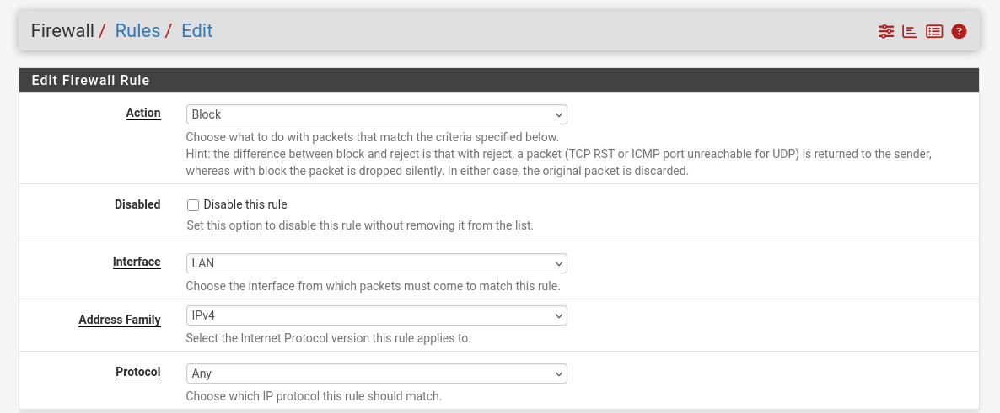

*Figure 21 — LAN firewall rule editor, including the selected `Block` action in this captured step.*

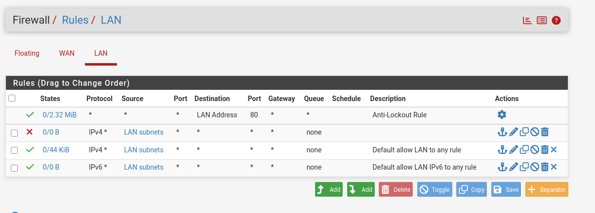

*Figure 22 — LAN rules table documenting the resulting policy entries.*

The document also contains Snort event monitoring in the pfSense interface, including ping-related alert entries. These are **observed security events**, not evidence of automatic packet blocking.

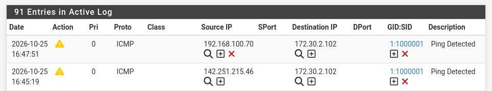

*Figure 23 — Snort alerts in the pfSense web interface.*

**Result:** I practiced interface assignment, creating and reviewing LAN policy, and inspecting firewall-integrated security monitoring. I have not claimed that a full end-to-end routing path between the earlier `172.30.1.x` lab and this later `172.30.2.x` lab was validated.

### 10. Configure Windows Server, DNS, and Active Directory

**Goal:** Extend the lab to Windows-based enterprise administration.

The source shows Windows Server 2022 in Server Manager, a DNS zone-creation wizard, and Active Directory Users and Computers (ADUC). These are predominantly **GUI-based administration steps**, so there are no invented PowerShell commands attributed to the screenshots.

**Observed workflow:**

1. Use **Server Manager** to inspect server identity, roles, and local-server settings.
2. Open **DNS Manager → Forward Lookup Zones → New Zone** to begin creating a forward-lookup DNS zone.
3. Open **Active Directory Users and Computers** to view or manage domain organizational units, users, and groups.
4. Review the settings shown by the screenshots rather than assuming a finished production-ready directory topology.

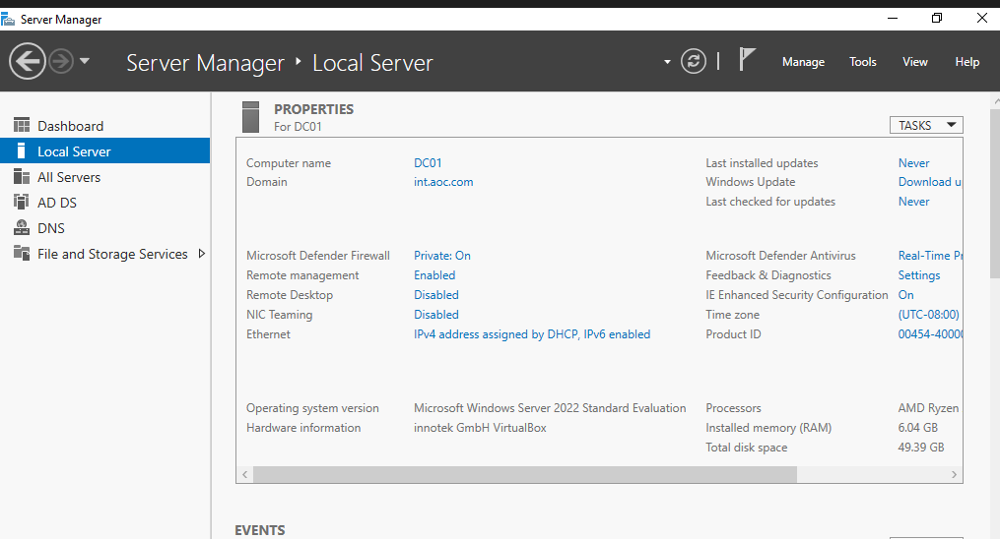

*Figure 24 — Local Server administration in Server Manager.*

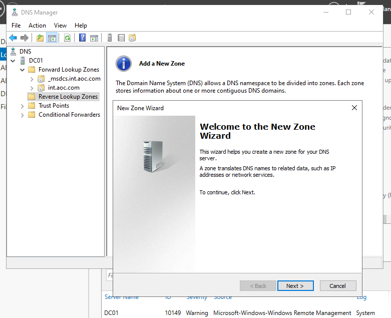

*Figure 25 — New Zone Wizard in DNS Manager.*

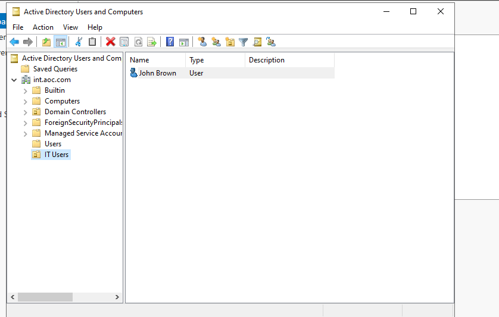

*Figure 26 — ADUC showing the directory structure and accounts.*

**Optional verification (not shown as executed):**

```powershell
Get-Service DNS
Get-ADDomain
```

`Get-Service DNS` would check the DNS service state; `Get-ADDomain` requires the Active Directory module and suitable permissions. These are examples for a repeatable checklist, not claims about the original lab execution.

### 11. Run vulnerability assessments with Nessus

**Goal:** Discover weaknesses in lab machines and learn the difference between a scan result and a verified finding.

The screenshots include the Nessus scan template selection screen, results, severity distributions, and a credentialed-scan configuration panel in the evidence gallery.

**GUI workflow:** select a template, configure the authorized target and scan settings, launch the scan, inspect the affected host/port and severity, and determine which findings need verification or remediation.

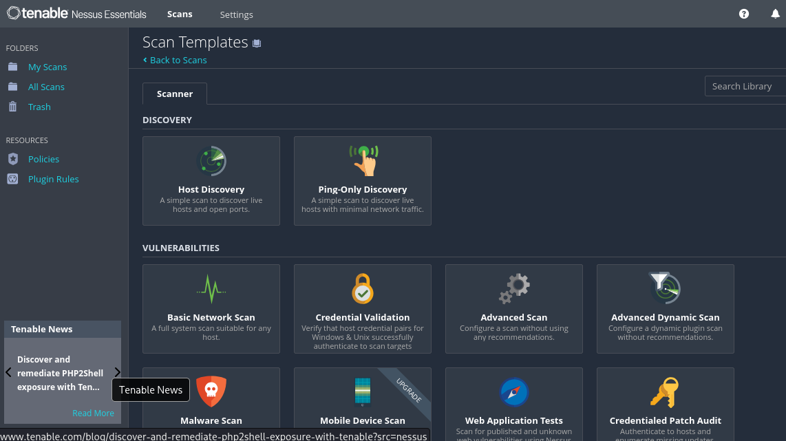

*Figure 27 — Scan templates available for host discovery and vulnerability assessment.*


*Figure 28 — Results listing for a deliberately vulnerable target.*


*Figure 29 — Host-level severity overview within Nessus.*

**Interpretation:** A scanner can identify potential CVEs, exposed services, or configuration weaknesses, but it does not automatically establish successful exploitation. Detailed unauthenticated versus authenticated scan results are kept in the separate Nessus project.

### 12. Add Wazuh security monitoring and endpoint visibility

**Goal:** Collect endpoint inventory and security telemetry centrally instead of reviewing each endpoint in isolation.

The source includes the Wazuh server VM, dashboard, agent/endpoint inventory, vulnerability dashboard, and later inventory data showing addresses on the `192.168.100.0/24` and `172.30.2.0/24` networks. Those later observations are shown separately from the first `172.30.1.0/24` experiments.

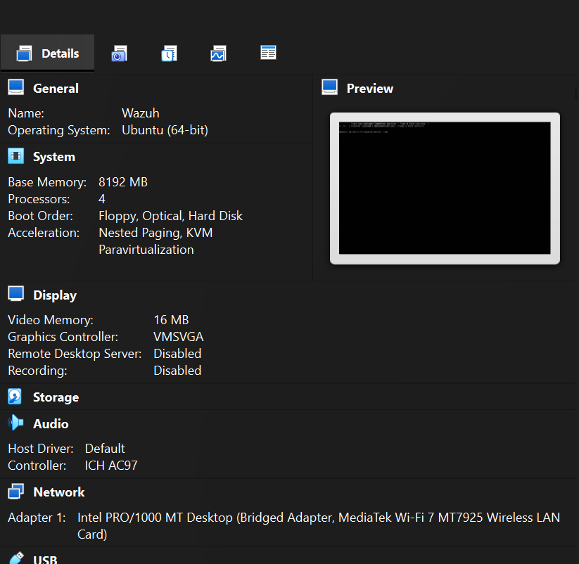

*Figure 30 — VirtualBox details for a Wazuh VM.*


*Figure 31 — Wazuh dashboard with monitored systems and security summaries.*


*Figure 32 — Agent/endpoint inventory, including interface and host visibility.*


*Figure 33 — Vulnerability severity overview.*

**Examples of addresses visible in this stage:** Wazuh manager `192.168.100.214`, Windows host `192.168.100.70`, and Kali internal interface `172.30.2.100`. A later screen cannot establish the earlier network's permanent route, so the project keeps them as different captured contexts.

**Optional verification on the manager (not evidenced as executed in the source screenshots):**

```bash
sudo systemctl status wazuh-manager
ip address
```

The first command checks whether the manager service is active; the second lists the server's interfaces. For a full Wazuh detection and EICAR/VirusTotal investigation, see the dedicated Wazuh repository rather than duplicating those claims here.

### 13. Explore Action1 endpoint management

**Goal:** Add inventory and patch/update visibility to the defensive side of the lab.

The Action1 screenshots show managed endpoint inventory and application/patch information. This adds administrative context alongside the attack-surface and detection tools used earlier.

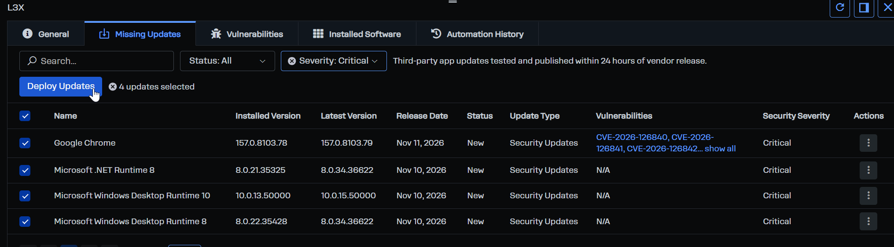

*Figure 34 — Action1 console showing managed devices and update information.*

**Result:** Exposure to a separate endpoint-management workflow. An inventory screen does not, by itself, demonstrate that specific patches were installed or that every host was fully remediated.

---

## Consolidated command reference

This table provides a quick, interview-ready summary of the commands represented in the original evidence. See the individual steps above for results and option explanations.

| Command | Operational purpose | Evidence status |
|---|---|---|
| `VBoxManage list dhcpservers` | Inspect VirtualBox DHCP service configurations | **Visible** in Windows screenshot |
| `VBoxManage dhcpserver add ... --enable` | Add the `VulnLabs` DHCP service and lease pool | **Visible** in Windows screenshot |
| `ip address` | Display Kali's interface addresses and statuses | **Visible** on Kali |
| `ifconfig` | Review Metasploitable 2 network interfaces | **Visible** on vulnerable VM |
| `ping 172.30.1.21` | Verify Kali-to-Metasploitable 2 reachability | **Visible**, replies received |
| `nmap -sn 172.30.1.1/24` | Discover active hosts without a port scan | **Visible**, three hosts reported |
| `nmap -sV 172.30.1.21` | Example of service-version enumeration | **Example only**; screenshot has results, not exact command |
| `vagrant plugin install vagrant-reload` | Add provisioning/reboot support plugin | **Visible**, installed |
| `vagrant plugin install vagrant-vbguest` | Start guest-additions plugin installation | **Visible**; completion not captured |
| `vagrant box add rapid7/metasploitable3-win2k8` | Add a vulnerable Windows VM box | **Visible**, provider prompt |
| `vagrant init metasploitable3` | Generate a Vagrantfile in that working directory | **Visible**, file created |
| `vagrant up` | Start VirtualBox provisioning of configured VM | **Visible**, import started |
| `ping 172.30.1.26` | Verify reachability in the Ubuntu/Snort stage | **Visible**, 0% packet loss |
| `sudo snort -T -i enp0s8 -c /etc/snort/snort.conf` | Validate Snort configuration | **Visible** command; validation output also shown |
| `sudo snort -q -l /var/log/snort -i enp0s8 -A console -c /etc/snort/snort.conf` | Monitor and print Snort alerts | **Visible**, ICMP alerts generated |
| `sudo snort -v -r /var/log/snort/snort.log.1792625255 \| less` | Read a saved Snort log with a pager | **Visible** as typed command; output not shown |
| `nmap -sS 172.30.1.26` | TCP SYN scan during security testing | **Visible**, SSH port 22 open |

For safety and accuracy, replay the commands only on your **own or explicitly authorized** lab systems. Addresses and VM names here are historical evidence, not guaranteed current configurations.

## What the evidence demonstrates

| Skill area | What was demonstrated | Limitation / follow-up |
|---|---|---|
| VM provisioning | VirtualBox, Vagrant box and VM boot workflow | Screenshots don't include a full portable Vagrantfile. |
| Network design | Internal, bridged and pfSense interface configuration | One verified universal end-to-end route was not provided. |
| Connectivity | Kali ping and Nmap host discovery with documented results | Reachability applies to the captured test stage. |
| Attack-surface inventory | Metasploitable 2 service identification | Port/service results are not proof of compromise. |
| Snort IDS | Config validation and multiple ICMP console alerts | No packet-blocking claim; Nmap-specific Snort alert not shown. |
| pfSense | WAN/LAN interface and rule configuration | GUI evidence does not show all inter-subnet routing tests. |
| Windows Server | Server Manager, DNS and ADUC administration | IP address and full deployment validation not documented. |
| Nessus | Scan templates and vulnerability findings | Separate repo covers detailed scan comparison. |
| Wazuh | Manager VM, agent inventory, vulnerability telemetry | Later networking stage kept distinct. |
| Action1 | Endpoint/update inventory | Does not show confirmed patch installation on every host. |

## Troubleshooting and lessons learned

**1. Separate virtual network names can isolate VMs.** `VulnLabs`, `Vulnlab1`, and `pfVulnlab1` appear in different snapshots. Even when IP ranges look similar, VirtualBox internal networks are separate unless adapters share the exact internal-network name or valid routing is configured. The earlier failed Windows ping and later successful Kali ping illustrate why the first debugging steps should be interface selection, address assignment, and reachability checks.

**2. A dual-homed VM requires careful route inspection.** Kali had both `192.168.100.207/24` and `172.30.1.20/24`. `ip address` confirms assigned addresses; `ip route` would be the next check before making claims about forwarding or outbound paths. Neither output proves that a virtual firewall sits in the traffic path.

**3. Detection is different from prevention.** Snort reported ICMP signatures after traffic was generated. That verifies alert generation in the tested setup. It does **not** show the packets were dropped. The pfSense rule table and Snort alert table are different evidence sources.

**4. Version and vulnerability findings require context.** Nmap identifies exposed versions; Nessus enriches that with vulnerability findings. Neither alone is a substitute for manual validation and risk prioritization.

**5. Good portfolio evidence includes what did not work.** The original source includes alternate VM adapter modes and a failed ping before later successful connectivity. Retaining those screenshots in the [supplementary gallery](EVIDENCE-GALLERY.md) makes the configuration process transparent and reproducible.

## Repository files and evidence index

```text
Cybersecurity-Virtual-Lab/
├── README.md                  # Technical walkthrough and command reference
├── NETWORK-TOPOLOGY.md       # Complete text-only topology and address evidence
├── EVIDENCE-GALLERY.md       # Extra setup and troubleshooting screenshots
├── SCREENSHOT-GUIDE.md       # Every screenshot matched to original DOCX image
├── UPLOAD-INSTRUCTIONS.txt   # GitHub upload steps
└── screenshots/              # 51 screenshots extracted from the original document
```

The original source document is **`Cyber Home Lab Doc 1.docx`**. Screenshots in this repository were extracted from that document and renamed for readability. The source document itself is not bundled in this repository.

For the full logical topology, see [NETWORK-TOPOLOGY.md](NETWORK-TOPOLOGY.md). For the supporting screenshot mapping, see [SCREENSHOT-GUIDE.md](SCREENSHOT-GUIDE.md).

## Security boundaries and scope

This lab used deliberately vulnerable systems. Do not expose them to a corporate network, the open internet, or systems you are not authorized to test. All documented addresses are private, historic lab observations. Screen captures are educational evidence; no claim of production deployment or independent third-party validation is made.

## Conclusion

This project helped me connect **virtualization and provisioning** to **practical network defense**. I configured multiple virtual systems, investigated address and network-mode differences, validated target reachability, documented Nmap service inventory, tested Snort alert generation, and explored virtual firewall policies, Windows infrastructure, vulnerability scanning, security monitoring, and endpoint management. The strongest takeaway was learning to interpret each screenshot or command result as a specific piece of evidence—not as proof that every security control or network path was permanently deployed.

**Author:** [Alexander Cox](https://www.linkedin.com/in/alexandercox25/) · [GitHub Portfolio](https://github.com/KerberosAC)
