# Cybersecurity Virtual Lab | Multi-VM Infrastructure & Security Testing

[](https://www.virtualbox.org/)
[](https://developer.hashicorp.com/vagrant)
[](https://www.kali.org/)
[](https://ubuntu.com/server)
[](https://wazuh.com/)
[](https://www.pfsense.org/)

**Author:** Alexander Cox  
**Project type:** Personal cybersecurity home lab  
**Primary source:** `Cyber Home Lab Doc 1.docx` (screenshots extracted from the original lab documentation)

## Overview

I designed and developed a multi-VM cybersecurity learning environment using **Oracle VirtualBox** and **Vagrant** on a Windows host. The lab allowed me to configure Linux systems and deliberately vulnerable practice targets, experiment with isolated network modes, validate connectivity, and build on the infrastructure with firewall, intrusion detection, directory services, vulnerability assessment, endpoint monitoring, and patch-management exercises.

The source document captures **multiple lab exercises and configuration stages**, not one single snapshot of a continuously running enterprise network. The README therefore distinguishes the *core lab build* from later security services, and does not assume every machine was simultaneously online or connected to the same subnet.

## Objectives

- Create and manage multiple VMs for controlled cybersecurity practice.
- Configure virtual adapters and explore **internal**, **bridged**, and other virtual networking options.
- Prepare a Kali Linux workstation and vulnerable Metasploitable targets.
- Use Vagrant with the VirtualBox provider to provision Metasploitable 3.
- Install and configure an Ubuntu Server environment.
- Validate network reachability with ICMP and discover hosts or services with Nmap.
- Extend the lab into defensive experiments using Snort, pfSense, Windows Server/Active Directory, Nessus, Wazuh, and Action1.
- Preserve configuration and results as repeatable evidence for a cybersecurity portfolio.

## Lab layout (plain text)

The following text map shows **which virtual machines and tools were documented in the home lab**, not verified routing or a single always-on network. The Windows host ran Oracle VirtualBox, and Vagrant was used for the Metasploitable 3 provisioning workflow.

```text
Windows Host PC
|
+-- Oracle VirtualBox (virtualization platform)
    |
    +-- Kali Linux VM
    |     Security testing, ping and Nmap discovery
    |
    +-- Metasploitable 2 VM
    |     Deliberately vulnerable Linux practice target
    |
    +-- Metasploitable 3 VM
    |     Vulnerable target provisioned using Vagrant
    |
    +-- Ubuntu Server / SnortVM (IDS)
    |     Linux administration and intrusion detection exercises
    |
    +-- pfSense VM
    |     Firewall configuration and network monitoring exercises
    |
    +-- Windows Server VM
    |     Active Directory and DNS administration
    |
    +-- Wazuh server VM
          Centralized endpoint monitoring exercises

Additional security platforms documented in the lab:
  - Nessus: vulnerability assessment
  - Action1: endpoint inventory and patch management
```

**Network configuration observations (not a verified end-to-end topology):**

```text
Kali Linux VM        Internal Network "VulnLabs" (one configuration)
Kali Linux VM        Bridged Adapter (a separate configuration/test)
Metasploitable 2 VM  Internal Network "Vulnlab1" (another configuration)

Lab connectivity tests:
  172.30.1.0/24      Nmap host discovery reported three hosts up
  172.30.1.21        Ping replies observed in one test
  172.30.1.26        Ping replies observed in a later test
```

**Scope:** The VM branches show lab inventory and administration through VirtualBox; they **do not** mean all VMs were running concurrently or that each shared the same subnet. The different adapter names and modes above are reproduced from separate documented screenshots.

### Extended virtual lab inventory

The original document also shows additional machines and platforms deployed or accessed during later exercises:

| Component | Purpose | Source evidence |
|---|---|---|
| Windows PC | Host for VirtualBox and Vagrant workflows | Host command prompt and VirtualBox settings |
| Kali Linux VM | Security testing, scanning, network troubleshooting | Kali terminal, network adapter, ping and Nmap results |
| Metasploitable 2 VM | Intentionally vulnerable Linux target | Internal-network settings and running console |
| Metasploitable 3 VM | Deliberately vulnerable target prepared through Vagrant | Vagrant logs, VirtualBox VM, console |
| Ubuntu Server VM | General-purpose Linux server environment | Installation and console screenshots |
| Snort VM / IDS work | Intrusion detection experiments | Snort installation and monitoring evidence |
| pfSense VM | Firewall and network security policy experimentation | pfSense console, GUI and LAN rules |
| Windows Server / Active Directory | Directory service and DNS administration | Server Manager and AD/DNS consoles |
| Nessus | Vulnerability assessment | Scan templates, result dashboards and credential settings |
| Wazuh server and endpoints | Centralized endpoint monitoring | Wazuh dashboard, inventory and vulnerability findings |
| Action1 | Endpoint inventory and patch management | Action1 device and management views |

**Topology caveat:** These are documented lab components across multiple exercises. VirtualBox networking screenshots explicitly show more than one configuration; the document does **not** establish one final interconnection or IP address for every system. Do not interpret the text-layout branches as verified network connections or packet paths.

### Network configuration and addressing evidence

- One Kali VirtualBox screenshot shows **Internal Network: `VulnLabs`**.
- Another Kali adapter screenshot shows a **Bridged Adapter** configuration; the lab explored more than one mode.
- A Metasploitable 2 screenshot shows **Internal Network: `Vulnlab1`**.
- A Kali test shows ping replies from **`172.30.1.21`**, followed by an Nmap discovery pass over **`172.30.1.0/24`** reporting **three active hosts**.
- Another connectivity test shows successful replies from **`172.30.1.26`**.
- These observations document connectivity at particular test stages; they are **not** proof of an unchanged final network topology.

## Tools and technologies

| Area | Tools |
|---|---|
| Virtualization & provisioning | Oracle VirtualBox, HashiCorp Vagrant |
| Operating systems | Windows host, Kali Linux, Ubuntu Server, Metasploitable 2 / 3, Windows Server |
| Networking & discovery | VirtualBox virtual adapters, `ping`, Nmap, Linux terminal utilities |
| Network security | pfSense, Snort |
| Identity & infrastructure | Windows Server, Active Directory, DNS |
| Vulnerability assessment | Nessus |
| Security monitoring | Wazuh, VirusTotal/EICAR test artifacts |
| Endpoint management | Action1 |

---

## Implementation and evidence

### 1. Prepare the Windows host and Oracle VirtualBox

I started by verifying the Windows host environment, launching Oracle VirtualBox, and reviewing the available virtual networking controls. Network settings were adjusted during the exercises rather than assuming the default VM adapter mode would be suitable for each task.


*Figure: Windows host command-line checks of the VirtualBox networking environment.*


*Figure: Kali Linux VirtualBox adapter set to the internal network named VulnLabs.*

**Observation:** The Kali VM was shown with an adapter attached to `VulnLabs` using VirtualBox's *Internal Network* mode. A separate screenshot documents a bridged adapter configuration during network troubleshooting (included in the evidence gallery).

### 2. Configure and launch Kali Linux

Kali Linux served as the principal security testing and network diagnostics machine. I inspected its network configuration and used command-line checks as the lab expanded.


*Figure: Kali Linux virtual machine running in the lab.*


*Figure: Kali Linux network configuration and interface output.*

### 3. Prepare the intentionally vulnerable Metasploitable targets

The lab documentation includes both **Metasploitable 2** and **Metasploitable 3**. Metasploitable 2 is shown with its own internal-network configuration and a running console. These targets are deliberately vulnerable and were used only in controlled exercises.

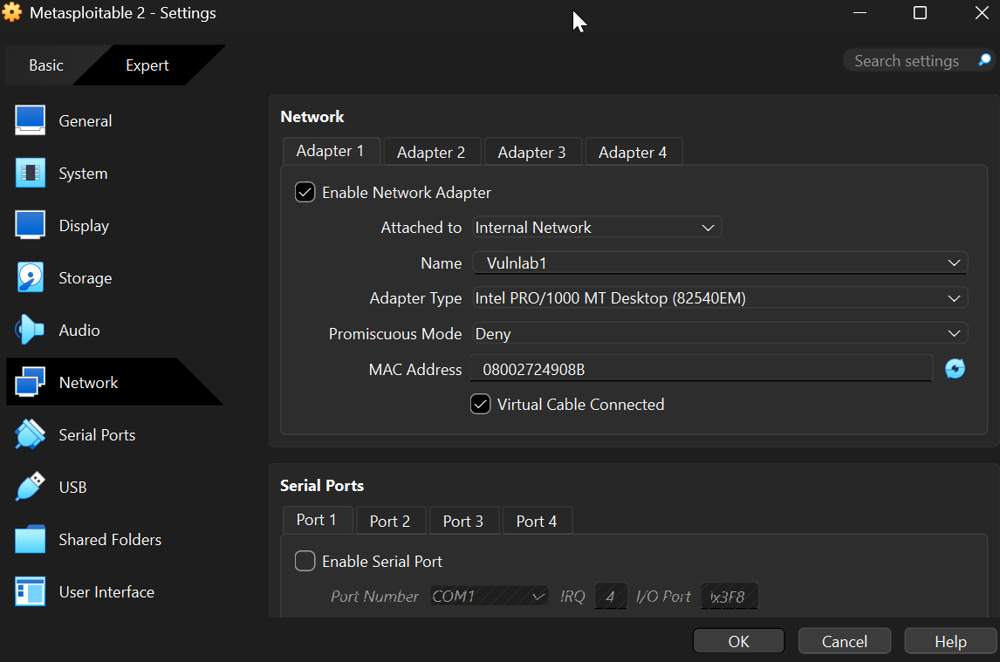

*Figure: Metasploitable 2 adapter configured on a separate internal network named Vulnlab1.*


*Figure: Metasploitable 2 console displaying network interface information.*

### 4. Validate connectivity and perform host discovery

I tested host reachability using `ping` and used Nmap to discover active virtual systems and examine the services exposed by test hosts.

A captured Nmap host-discovery result reported **three hosts up** on the `172.30.1.0/24` lab network. Other screenshots recorded both failed and successful connectivity tests, providing troubleshooting evidence rather than only the final result.

```bash
# Commands illustrated by the lab work
ping 172.30.1.21
nmap -sn 172.30.1.1/24
```

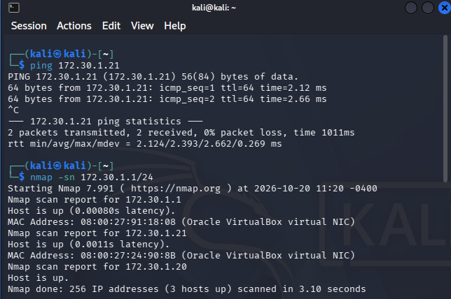

*Figure: Kali Linux ping and Nmap discovery on the 172.30.1.0/24 lab subnet.*

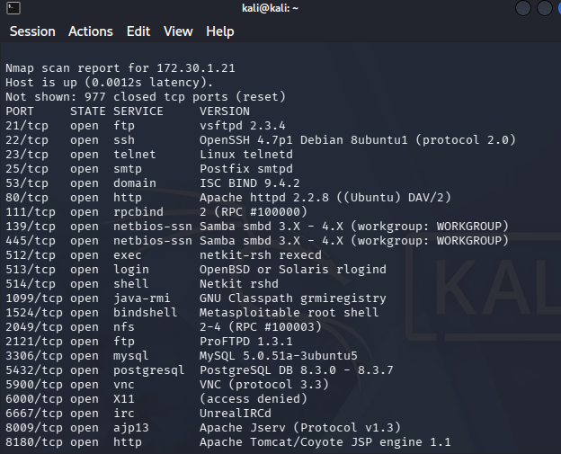

*Figure: Nmap output showing enumerated ports and services on a lab host.*

**Result:** The testing machine identified active hosts and demonstrated service enumeration in the virtual lab. Findings apply only to the captured configuration and observation time.

### 5. Use Vagrant to provision Metasploitable 3

Vagrant was installed on the Windows host as part of the VM provisioning workflow. I worked with the VirtualBox provider and used command-line steps to prepare and start the Metasploitable 3 environment.

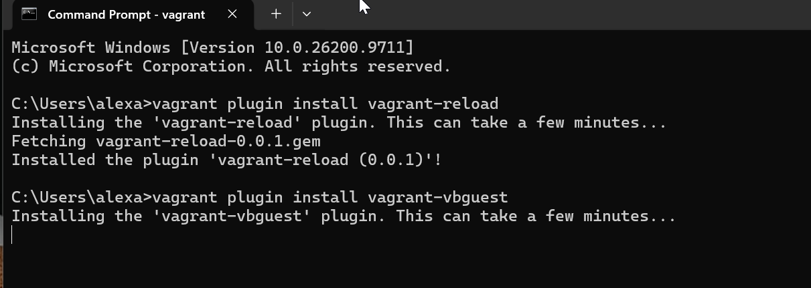

*Figure: Windows command prompt documenting Vagrant plugin installation.*

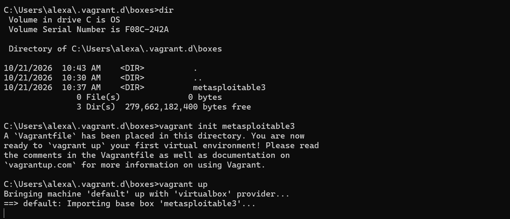

*Figure: Vagrant-driven Metasploitable 3 provisioning and startup output.*


*Figure: Metasploitable 3 virtual machine visible in Oracle VirtualBox.*


*Figure: Running Metasploitable 3 virtual machine console.*

**Result:** The source screenshots document the Vagrant setup workflow and Metasploitable 3 visible in VirtualBox with its running console.

### 6. Install and test Ubuntu Server

I prepared an Ubuntu Server environment (shown during installation as `SnortVM (IDS)`), progressed through its installer, and accessed its terminal. The downloaded media and installed console in the document show **different Ubuntu release numbers** during the workflow; the final screenshot itself reports Ubuntu 24.04.5 LTS. Subsequent Kali testing confirmed replies from a lab endpoint at `172.30.1.26`.


*Figure: Ubuntu Server installation screen within the VM named SnortVM (IDS).*


*Figure: Ubuntu Server console after setup.*


*Figure: Successful ping replies from a lab host at 172.30.1.26.*

The connectivity result is evidence of communication during this test, but the screenshots alone do not establish a persistent IP assignment for every machine.

### 7. Extend the lab with Snort intrusion detection

The lab was expanded with a **Snort-based intrusion detection** environment. Terminal output shows installation or preparation activity and packet-monitoring/test output. A Kali Nmap scan was also documented as controlled network security test traffic.


*Figure: SnortVM (IDS) VirtualBox settings showing an Ubuntu-based virtual machine.*


*Figure: Terminal output from Snort IDS installation and preparation.*


*Figure: Snort traffic monitoring or alert output in the lab.*


*Figure: Kali Linux Nmap scan used during network security testing.*

**Learning outcome:** Exposure to IDS setup, log interpretation, and the relationship between test traffic and monitoring output. No unsupported claim of automatic blocking is made.

### 8. Configure pfSense as a virtual firewall

A pfSense firewall VM was launched and configured through its console and web interface. The screenshots show LAN rule editing and the use of Snort monitoring within pfSense.

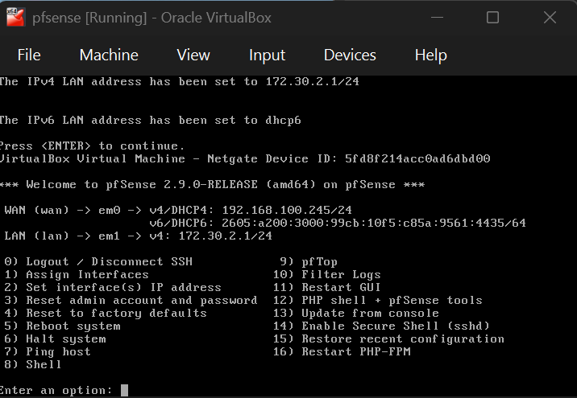

*Figure: pfSense firewall virtual machine console.*

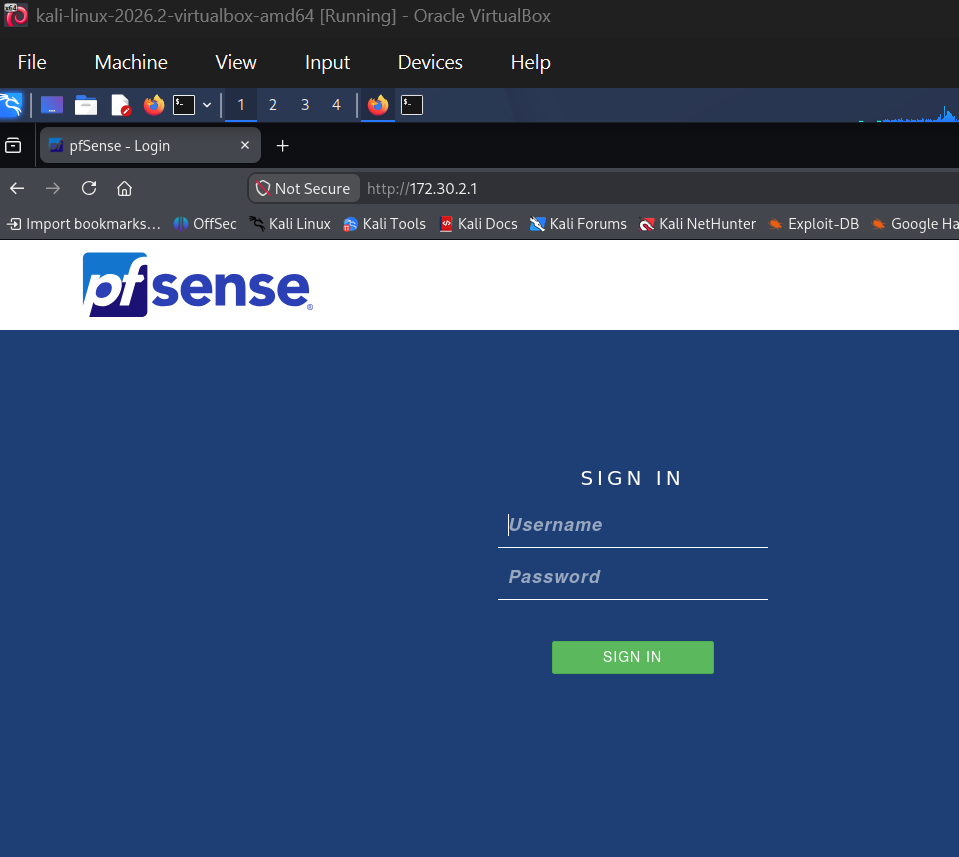

*Figure: pfSense web management login screen.*


*Figure: pfSense firewall rule creation and editing interface.*


*Figure: pfSense LAN firewall rules table.*


*Figure: Snort alerts visible through the pfSense management interface.*

**Learning outcome:** Firewall GUI administration, interface and policy management, and reviewing defensive monitoring information.

### 9. Build Windows Server and Active Directory fundamentals

The documentation captures Windows Server administrative setup, DNS zone configuration, and Active Directory management. These exercises extended the lab beyond Linux-only targets to a Windows enterprise-style infrastructure workflow.


*Figure: Windows Server Manager showing the server administration environment.*


*Figure: Windows Server DNS zone setup wizard.*


*Figure: Active Directory Users and Computers management console.*

### 10. Add vulnerability assessment with Nessus

The lab includes Nessus installation/onboarding and scans in a browser-based security assessment interface. Screenshots show the available scan templates and findings or severity views, with an additional credentialed-scan settings example in the gallery.


*Figure: Nessus scan templates in the browser-based interface.*

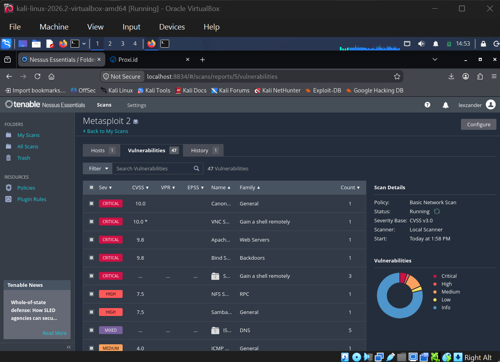

*Figure: Nessus scan results displaying discovered vulnerability findings.*

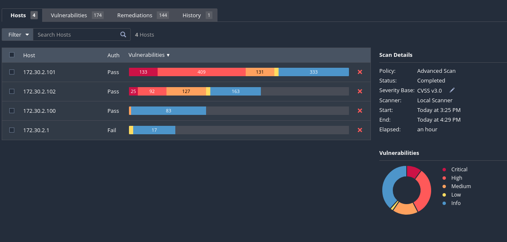

*Figure: Nessus vulnerability results and severity distribution.*

**Learning outcome:** Scan configuration, reviewing findings, and comparing vulnerability information in a controlled lab. Individual findings and remediation are documented in the separate Nessus project.

### 11. Deploy Wazuh endpoint security monitoring

The Wazuh exercise adds a centralized security monitoring component, with a virtual manager, web dashboard, monitored endpoint inventory, and vulnerability detection information.


*Figure: VirtualBox view of the virtual machine used for Wazuh monitoring.*

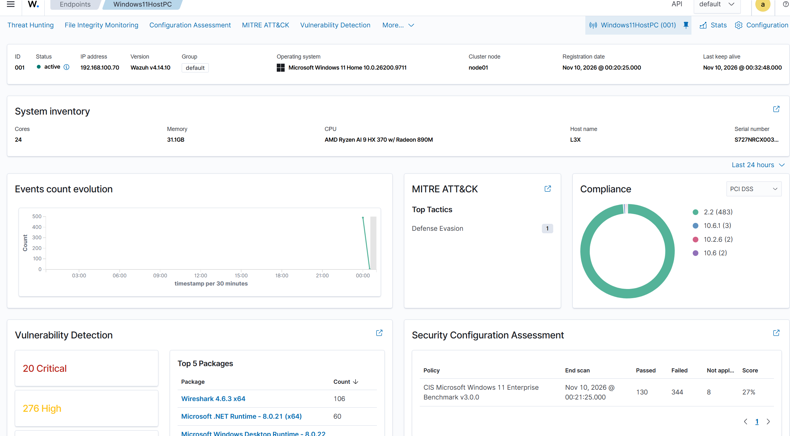

*Figure: Wazuh security monitoring dashboard.*

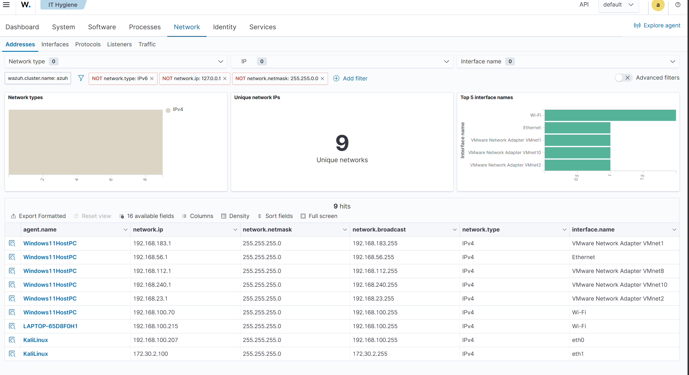

*Figure: Wazuh endpoint inventory and agent telemetry.*

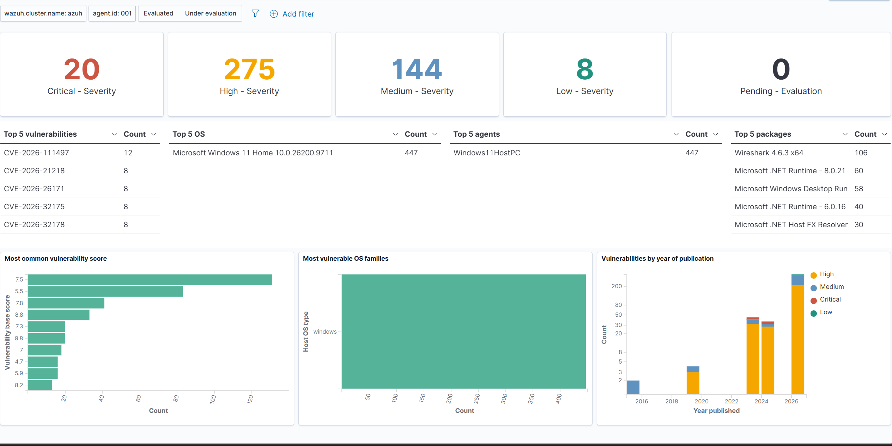

*Figure: Wazuh vulnerability dashboard by severity.*

**Learning outcome:** Host visibility, SIEM/XDR interface navigation, agent inventory, and vulnerability telemetry. Detailed EICAR and VirusTotal validation is covered in the separate Wazuh repository.

### 12. Inspect endpoint patch-management workflows

The home-lab document also shows Action1 endpoint management screens, adding a management-focused view of endpoints to complement the assessment and detection systems.


*Figure: Action1 device inventory shown in the home-lab document.*

---

## Validation summary

| Capability | Evidence visible in the lab document |
|---|---|
| Virtual machine administration | VirtualBox VM settings, running desktops and consoles |
| Internal/bridged virtual networking | VirtualBox adapter configuration screens |
| Kali Linux networking | Terminal network information, ICMP and Nmap output |
| Metasploitable practice targets | VM configuration, Vagrant workflow and consoles |
| Ubuntu Server setup | VM configuration, installation and command line |
| Network reconnaissance | Nmap output identifying active hosts and services |
| IDS / network defense | Snort installation and monitoring, pfSense firewall UI |
| Windows infrastructure | Windows Server, AD and DNS administration screenshots |
| Vulnerability scanning | Nessus scan views and result dashboards |
| Endpoint detection & monitoring | Wazuh dashboards, agent inventory, vulnerability findings |
| Endpoint management | Action1 management screens |

**Important distinction:** A setup screenshot proves the configuration was reached; it does not necessarily prove every feature was fully deployed, secured, or validated in production. The screenshots support lab experimentation, not a production assessment.

## Challenges and lessons learned

- **Virtual network mode matters:** Internal, bridged, and host-only choices change reachability and isolation. Screenshots capture different configurations during testing.
- **Connectivity validation comes first:** ICMP checks and Nmap host discovery helped establish which lab systems were reachable before further exercises.
- **Provisioning is its own skill:** Vagrant and VirtualBox workflows showed how reproducible test environments can be prepared.
- **Layered security uses different telemetry:** pfSense and Snort focus on network control and detection, while Wazuh and Nessus provide different endpoint and vulnerability views.
- **Isolation is essential:** Deliberately vulnerable Metasploitable systems should not be exposed to untrusted or production networks.
- **Good evidence needs context:** Every screenshot in this repository is mapped to its original embedded image number in `SCREENSHOT-GUIDE.md`.

## Evidence gallery and file organization

For the full sequence, configuration alternatives, troubleshooting screenshots, and supplemental examples, see **[Evidence Gallery](EVIDENCE-GALLERY.md)**. For every screenshot's original number and filename, see **[Screenshot Guide](SCREENSHOT-GUIDE.md)**.

```text
Cybersecurity-Virtual-Lab/
├── README.md
├── EVIDENCE-GALLERY.md
├── SCREENSHOT-GUIDE.md
├── UPLOAD-INSTRUCTIONS.txt
└── screenshots/
    └── 49 curated lab screenshots (descriptively named)
```

## Security and scope

This is a **personal educational virtual lab**, documented from `Cyber Home Lab Doc 1.docx`. VMs such as Metasploitable are intentionally insecure; they belong on a controlled network with appropriate isolation. Private addressing shown in screenshots is historical lab data, not a current network reachability guarantee.

This repository does not contain passwords, live credentials, exploit payloads, or sensitive raw configuration exports. Review screenshots before posting publicly if your lab usernames, device identifiers, or private environment details have changed.

## Key takeaway

Building this lab strengthened my practical understanding of virtualization, isolated networking, Linux/Windows infrastructure, reconnaissance, vulnerability assessment, and security monitoring. The most valuable outcome was having a reusable environment in which infrastructure configuration and security controls could be learned through documented, repeatable exercises.

**Author:** [Alexander Cox](https://www.linkedin.com/in/alexandercox25/) · [GitHub Portfolio](https://github.com/KerberosAC)
